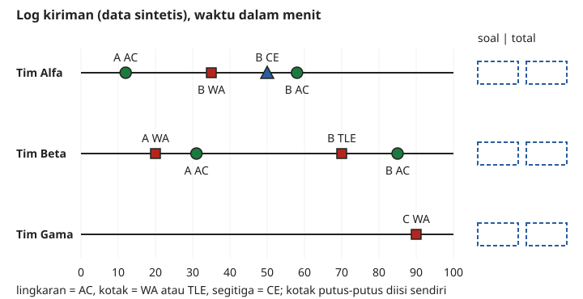

**Ingat dulu:** Tanpa melihat catatan dan tanpa komputer, jawab. (1) Mengapa Dijkstra gagal pada bobot negatif, dan apa kompleksitasnya dengan heap? (2) Tulis operasi `cari` dan `gabung` DSU. Mengapa kompresi jalur menolong?

(1) ______

(2) ______



`[Gambar: garis waktu 0 sampai 100 menit untuk tiga tim rekaan. Tim Alfa: A AC menit 12; B WA menit 35, B CE menit 50, B AC menit 58. Tim Beta: A WA menit 20, A AC menit 31; B TLE menit 70, B AC menit 85. Tim Gama: C WA menit 90. Di kanan tiap tim dua kotak kosong, jumlah soal dan total waktu; diisi pada soal Prediksi.]`

**Prediksi (bagian 2, pertemuan 3 sampai 10):** Waktu sebuah soal yang selesai adalah menit kiriman diterima pertama ditambah 20 menit untuk setiap kiriman sebelumnya yang ditolak untuk soal itu, kecuali yang ditolak karena kesalahan kompilasi (CE). Soal yang tak selesai tidak menambah waktu. Isi dua kotak tiap tim pada gambar, lalu tulis urutan papan peringkat.

Urutan papan peringkat: ______ , ______ , ______

**Prediksi (bagian 1):** Satu komputer, empat soal yang memerlukan 40, 10, 25, dan 15 menit menulis dan mengirim, dikerjakan berurutan dan semua diterima pada percobaan pertama. Total waktu tim = jumlah waktu selesai tiap soal. Berapa totalnya dengan urutan 10, 15, 25, 40? ______ Dan dengan urutan terburuk? ______

**Lengkapi:** Isi bagian kosong.

```cpp setengah-jadi
// bagian 1: urutkan soal terpendek dulu, est[i] = perkiraan menit soal i
vector<int> urut(n);
iota(urut.begin(), urut.end(), 0);
sort(urut.begin(), urut.end(), [&](int a, int b) {
    return est[______] < est[______];
});
```

```cpp setengah-jadi
// bagian 2: aturan penalti satu soal
int waktuSoal(int menitTerima, int salah) {
    return menitTerima + ______ * salah;
}
```

```cpp setengah-jadi
// bagian 3: penyebab penolakan menurut urutan tiga pertanyaan analisis
string penyebab(bool algoritmaBenar, bool kodeSesuai, bool kasusTepiAman) {
    if (!algoritmaBenar) {
        return "algoritma";
    }
    if (!______) {
        return "kode";
    }
    if (!______) {
        return "kasus tepi";
    }
    return "lainnya";
}
```

**Latihan:**

1. (Bagian 3) Solusi O(n) berikut dikirim tim untuk soal karangan "cari jumlah terbesar sub-larik tak kosong". Ia lolos contoh tetapi ditolak (WA). Tebak masukan kecil yang mematahkannya, dan tulis perbaikannya. AI: tanpa AI.

```text setengah-jadi
terbaik = 0
sekarang = 0
untuk tiap x:
    sekarang = max(x, sekarang + x)
    terbaik = max(terbaik, sekarang)
cetak terbaik
```

Masukan penyangkalku: ______ . Perbaikanku: ______

2. (Bagian 2) Hitung waktu sebuah soal yang diterima menit 47 setelah dua penolakan WA dan satu kesalahan kompilasi.
3. (Bagian 1) Untuk durasi 5, 20, 10 menit, tulis urutan dan total waktu terkecil.
4. (Bagian 3) Sebut tiga pertanyaan analisis soal yang gagal, berurutan. Jelaskan mengapa pembanding harus ditulis sangat sederhana, dan mengapa generator memakai nilai kecil.
5. (Bagian 4) Tulis kerangka refleksi satu halaman: data (soal selesai, penolakan per jenis), pola, rencana (tiga kebiasaan, tiga teknik, satu target terukur), peran.

Ruang jawaban: ______

**Cek diri:**

- [ ] Aku dapat mengatur waktu: membaca semua soal, mengurutkan, menjaga 30 menit terakhir.
- [ ] Aku dapat menulis pembanding dan generator acak kecil.
- [ ] Aku punya rencana latihan berangka dengan tanggal tinjau.

**Catatan cetak (untuk dosen, tidak dicetak):** tiga halaman A4. Kunci dan petunjuk ada di modul `kul-k-401` bagian "Kunci dan petunjuk". Modul tidak memuat soal Parsons, sehingga bagian Susun dilewati. Lembar tidak memuat kolom nama, NIM, tanggal, atau nilai.
