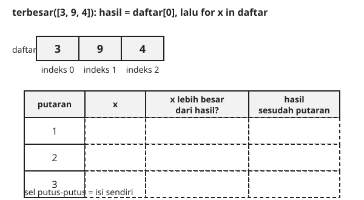

**Ingat dulu:** Tanpa melihat catatan, jawab. (1) Tuliskan tanda tangan (kepala) fungsi bernama `luas` yang menerima `p` dan `l`. (2) Apa beda `if` dan `elif`? (3) Apa yang dicetak `print(2 + 3 * 4)`?

(1) ______

(2) ______

(3) ______



`[Gambar: daftar tiga kotak berisi 3, 9, 4 dengan indeks 0, 1, 2. Di bawahnya tabel penelusuran: kolom putaran, x, apakah x lebih besar dari hasil, dan hasil sesudah putaran; tiga baris, semua sel kosong. Diisi pada soal Lengkapi.]`

**Prediksi (bagian 1):** Tanpa menjalankan, tulis keluaran program ini dan nilai tiap variabel setelah tiap baris.

```python
harga = 5000
jumlah = 3
total = harga * jumlah
if total > 12000:
    total = total - 2000
print("Total:", total)
```

Keluaran: ______

| Setelah baris | harga | jumlah | total |
| --- | --- | --- | --- |
| 1 | | | |
| 2 | | | |
| 3 | | | |
| 5 | | | |

**Prediksi (bagian 2):** Tulis tiap baris keluaran program ini.

```python
total = 0
for angka in [4, 7, 1]:
    total = total + angka
    print(angka, total)
```

Keluaranku: ______

**Lengkapi (bagian 2):** Isi bagian kosong, lalu isi tabel penelusuran `terbesar([3, 9, 4])` pada gambar.

```python setengah-jadi
def terbesar(daftar):
    if ______:
        return None
    hasil = daftar[0]
    for x in ______:
        if x > hasil:
            hasil = ______
    return hasil
```

**Lengkapi (bagian 1 dan 3):** Ongkos kirim gratis bila belanja minimal 100000, selain itu 10000. Stok yang kurang dari 5 dicatat sebagai menipis.

```python setengah-jadi
belanja = int(input("Belanja: "))
if belanja ______ 100000:
    ongkos = ______
else:
    ongkos = ______
print("Ongkos:", ongkos)
```

```python setengah-jadi
stok = {"pensil": 10, "buku": 4, "penggaris": 2}
menipis = []
for nama, jumlah in stok.______():
    if jumlah ______ 5:
        menipis.append(nama)
print(sorted(menipis))
```

**Susun (bagian 1):** Susun baris-baris acak ini menjadi program yang mencetak "genap" atau "ganjil" untuk `n = 7`. Indentasi ditentukan sendiri.

- A. `print("ganjil")`
- B. `if n % 2 == 0:`
- C. `n = 7`
- D. `else:`
- E. `print("genap")`

Urutanku: ______ , ______ , ______ , ______ , ______

**Latihan:**

1. (Bagian 3) Prediksi keluaran `print(sorted(stok.items()))` setelah `stok = {"pensil": 10, "buku": 4}`, `stok["buku"] = stok["buku"] + 6`, dan `stok["penghapus"] = 2`. AI: tanpa AI.
2. (Bagian 4) Prediksi keluaran program yang menjumlahkan kolom `jumlah` per `kategori` dari data CSV `kategori,jumlah` dengan baris `alat tulis,3`, `buku,5`, `alat tulis,4`.
3. (Bagian 5) Mana yang gagal: `assert rata_rata_salah([70, 80, 90]) == 80` dengan `rata_rata_salah` mengembalikan `sum(daftar) / (len(daftar) + 1)`? Berapa hasilnya?
4. (Bagian 3) Untuk (a) daftar nama berurutan, (b) pencarian harga menurut nama barang, (c) membuang kembaran, pilih `list`, `dict`, atau `set`, dan beri satu alasan tiap pilihan.
5. (Bagian 5) Tulis tiga kasus uji untuk `terbesar`, termasuk daftar kosong. AI: tanpa AI.

Ruang jawaban: ______

**Cek diri:**

- [ ] Aku dapat menelusuri program pendek di kertas.
- [ ] Aku dapat menulis fungsi dengan kasus tepi.
- [ ] Aku dapat menulis uji yang gagal bila kode salah.

**Catatan cetak (untuk dosen, tidak dicetak):** dua sampai tiga halaman A4. Kunci dan petunjuk ada di modul `kul-u-101` bagian "Kunci dan petunjuk". Lembar tidak memuat kolom nama, NIM, tanggal, atau nilai.
