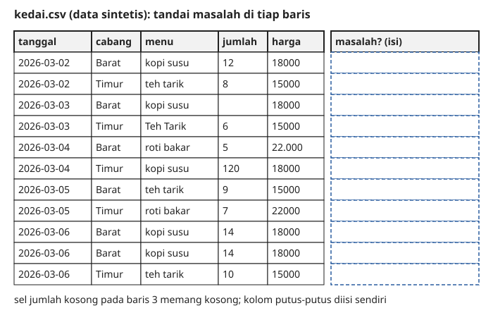

**Ingat dulu:** Tanpa melihat catatan, jawab. (1) Tulis dua baris Python yang membaca satu berkas CSV dengan `csv.DictReader` dan mencetak kolom `kategori` tiap baris. Mengapa nilai angka dari CSV perlu diubah dengan `int(...)` sebelum dijumlahkan? (2) Tulis satu `assert` yang gagal bila fungsi `rata_rata([70, 80, 90])` tidak mengembalikan 80.

(1) ______

(2) ______



`[Gambar: tabel sebelas baris data penjualan sintetis kedai (tanggal, cabang, menu, jumlah, harga) dengan satu kolom kosong bernama masalah. Baris 3 jumlah kosong, baris 4 menu ditulis Teh Tarik, baris 5 harga 22.000, baris 6 jumlah 120, baris 9 dan 10 sama persis. Dipakai pada soal Prediksi: tulis semua masalah sebelum menulis kode.]`

**Prediksi (bagian 1, pertemuan 1 sampai 3):** Tanpa menulis kode, isi kolom masalah pada gambar untuk tiap baris yang bermasalah. Lalu jawab: mengapa satu sel kosong mengubah tipe kolom `jumlah` dari bilangan bulat menjadi `float64`?

Jawabanku: ______

**Prediksi (bagian 1):** Tulis dua baris keluaran program ini. Baris kedua adalah (banyak baris, banyak kolom).

```python
import pandas as pd

d = pd.DataFrame({"menu": ["kopi", "teh", "kopi"], "jumlah": [3, 5, 4]})
print(d["jumlah"].sum())
print(d[d["menu"] == "kopi"].shape)
```

Keluaranku: ______ dan ______

**Prediksi (bagian 2):** Apa isi `s` setelah baris terakhir, dan berapa `s.nunique()`?

```python
import pandas as pd

s = pd.Series([" Teh ", "teh", "KOPI"])
s = s.str.strip().str.lower()
print(s.nunique())
print(s.tolist())
```

Keluaranku: ______ dan ______

**Lengkapi:** Isi bagian kosong.

```python setengah-jadi
import pandas as pd

df = pd.read_csv("kedai.csv")
barat = df[df["cabang"] ______ "Barat"]
print(len(______))
print(df[df["cabang"] == "Timur"]["jumlah"].______())
```

```python setengah-jadi
import pandas as pd


def bersihkan(df):
    catatan = {}
    n0 = len(df)
    df = df.drop_duplicates()
    catatan["kembar"] = n0 - len(df)
    n1 = len(df)
    df = df.dropna(subset=["jumlah"])
    catatan["kosong"] = n1 - len(______)
    return df, ______
```

```python setengah-jadi
import pandas as pd

df = pd.read_csv("kedai_bersih.csv")
per_cabang = df.______("cabang")["jumlah"].mean()
print(per_cabang)
print(per_cabang.______())
```

```python setengah-jadi
import pandas as pd


def bersihkan(df):
    df = df.dropna(subset=["jumlah"])
    return df[df["jumlah"] <= 50]


kecil = pd.DataFrame({"jumlah": [5.0, ______, 500.0]})
assert len(bersihkan(kecil)) == ______
print("uji lolos")
```

**Latihan:**

1. (Bagian 3) Dua daftar jumlah penjualan: `[10, 10, 10, 10]` dan `[1, 1, 1, 37]`. Mana yang rata-ratanya lebih besar, mana yang mediannya lebih besar, dan mengapa jawabannya berbeda? AI: tanpa AI.
2. (Bagian 4) Dua grafik batang memperlihatkan data yang sama, yaitu 98 dan 100. Satu memulai sumbu vertikal dari 0, satu dari 97. Tulis satu kalimat tentang kesan tiap grafik.
3. (Bagian 5) Sebuah notebook punya tiga sel: (1) `n = 5`, (2) `n = n * 2`, (3) `print(n)`. Kamu menjalankan sel 1, 2, lalu 2 sekali lagi, lalu 3. Apa keluaran sel 3? Bila notebook dimulai ulang dan dijalankan berurutan, apa keluarannya?
4. (Bagian 6) Seorang peneliti menyebar survei uang saku di grup pesan satu fakultas. Tulis dua alasan rata-ratanya mungkin tidak mewakili seluruh mahasiswa. AI: tanpa AI.
5. (Bagian 2) Sel kosong dan angka janggal 120 butuh keputusan. Tulis tiga pilihan untuk sel kosong dan mengapa keputusan itu dicatat.

Ruang jawaban: ______

**Cek diri:**

- [ ] Aku dapat memuat dan memeriksa tabel baru sebelum menghitung.
- [ ] Aku dapat membersihkan data dan mencatat tiap keputusan.
- [ ] Aku dapat membuat alur yang dapat diulang dari nol.

**Catatan cetak (untuk dosen, tidak dicetak):** tiga halaman A4. Kunci dan petunjuk ada di modul `kul-u-102` bagian "Kunci dan petunjuk". Modul tidak memuat soal Parsons, sehingga bagian Susun dilewati. Lembar tidak memuat kolom nama, NIM, tanggal, atau nilai.
