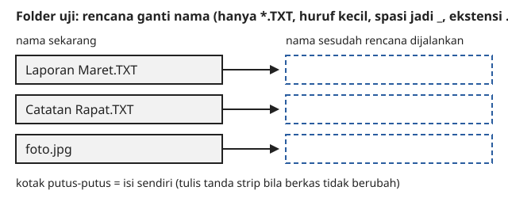

**Ingat dulu:** Tanpa melihat catatan, jawab. (1) Mengapa fungsi yang mengembalikan nilai dengan `return` lebih mudah diuji dengan `assert` daripada fungsi yang hanya memakai `print`? (2) Mengapa hasil pembersihan data sebaiknya ditulis ke berkas lain, bukan menimpa data mentah?

(1) ______

(2) ______



`[Gambar: tiga berkas di folder uji (Laporan Maret.TXT, Catatan Rapat.TXT, foto.jpg), tiap berkas dengan panah ke kotak kosong untuk nama sesudah rencana ganti nama dijalankan. Aturan: hanya berkas .TXT, huruf kecil, spasi menjadi garis bawah, ekstensi .txt. Dipakai pada soal Prediksi bagian 1.]`

**Prediksi (bagian 1, pertemuan 1 sampai 3):** Isi kotak pada gambar. Lalu tulis keluaran program ini.

```python
from collections import Counter
from pathlib import PurePath

daftar = ["a.txt", "b.csv", "c.txt", "arsip.tar.gz", "README"]
print(Counter(PurePath(n).suffix for n in daftar))
print(PurePath("arsip.tar.gz").stem)
```

Keluaranku: ______ dan ______

**Prediksi (bagian 2 dan 3):** Isi tiap keluaran.

```python
import re

teks = "rapat 2026-03-05, tenggat 2026-03-12; ruang 7"
print(re.findall(r"\d{4}-\d{2}-\d{2}", teks))
print(re.sub(r"\d", "#", "ruang 7"))
```

```python
import json

teks = '{"kota": "Contohkota", "suhu": [29, 31], "hujan": false, "catatan": null}'
data = json.loads(teks)
print(data["suhu"][1])
print(data["hujan"], data["catatan"])
print(json.dumps({"ok": True, "nilai": None}))
```

Keluaranku (regex): ______ dan ______

Keluaranku (JSON): ______ ; ______ ; ______

**Lengkapi:** Isi bagian kosong.

```python setengah-jadi
import csv
from pathlib import Path


def hitung_baris(folder):
    hasil = {}
    for p in sorted(Path(folder).glob("*.______")):
        with open(p, newline="", encoding="utf-8") as f:
            hasil[p.name] = sum(1 for _ in csv.______(f)) - 1
    return hasil
```

```python setengah-jadi
import re

judul = "Laporan  Maret__2026 final"
print(re.sub(r"[______]+", "-", judul))
```

```python setengah-jadi
import time
import urllib.error


def ambil_dengan_ulang(fungsi, percobaan=3, jeda=0.1):
    for ke in range(1, percobaan + 1):
        try:
            return fungsi()
        except urllib.error.HTTPError as galat:
            if galat.code == ______ or ke == percobaan:
                raise
            time.sleep(jeda * ke)
```

```python setengah-jadi
import logging

logging.basicConfig(
    filename="rekap.log",
    level=logging.INFO,
    format="%(______)s %(levelname)s %(message)s",
)
logging.info("mulai")
```

**Latihan:**

1. (Bagian 5) Baca skrip berikut seperti peninjau. Tandai tiga masalah keamanan, lalu tulis perbaikannya. AI: tanpa AI.

```python
import subprocess
import urllib.request

KUNCI = "kunci-latihan-palsu"


def unduh(nama_berkas):
    url = "https://layanan.example/data/" + nama_berkas
    req = urllib.request.Request(url, headers={"Authorization": KUNCI})
    subprocess.run("curl -O " + url, shell=True)
```

Masalah 1: ______ Masalah 2: ______ Masalah 3: ______

2. (Bagian 5) Seorang mahasiswa menulis `KUNCI = "abc123"` langsung di skrip lalu mengunggah repositori ke layanan publik. Tulis tiga hal yang dapat terjadi dan satu langkah yang tidak cukup untuk memperbaikinya.
3. (Bagian 4) Program memproses tiga item, item kedua gagal. Apa yang terlihat di log, dan apakah item ketiga tetap diproses? Mengapa jalur relatif sering gagal ketika skrip dijadwalkan?
4. (Bagian 6) Berkas `robots.txt` menyatakan folder `/privat/` tidak boleh diambil skrip dan meminta jeda 5 detik. Tulis keputusanmu untuk `/umum/a` dan `/privat/a`.
5. (Bagian 2) Apa beda `match`, `fullmatch`, dan `search`, dan kapan `fullmatch` lebih aman? AI: tanpa AI.

Ruang jawaban: ______

**Cek diri:**

- [ ] Aku dapat menulis skrip berkas dengan rencana dan penolakan menimpa.
- [ ] Aku dapat mencatat dan menjadwalkan skrip yang aman diulang.
- [ ] Aku dapat menjaga rahasia dan menilai risiko skrip orang lain.

**Catatan cetak (untuk dosen, tidak dicetak):** tiga halaman A4. Kunci dan petunjuk ada di modul `kul-u-201` bagian "Kunci dan petunjuk". Modul tidak memuat soal Parsons, sehingga bagian Susun dilewati. Lembar tidak memuat kolom nama, NIM, tanggal, atau nilai.
