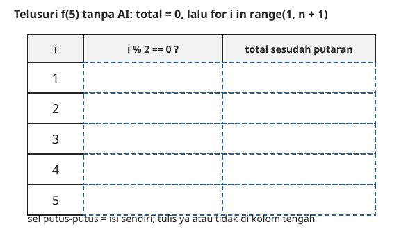

**Ingat dulu:** Tanpa melihat catatan, jawab. (1) Mengapa kunci API, atau skrip yang memuat kunci itu, tidak boleh ditempelkan ke asisten AI? (2) Mengapa skrip yang dihasilkan pihak lain, termasuk AI, diperlakukan seperti kode orang asing sebelum dijalankan pada data nyata?

(1) ______

(2) ______



`[Gambar: tabel penelusuran fungsi f(5) dengan tiga kolom: i (sudah terisi 1 sampai 5), apakah i habis dibagi 2, dan total sesudah putaran. Dua kolom terakhir kosong. Total awal 0. Dipakai pada soal Lengkapi gerbang kesiapan.]`

**Prediksi (bagian 1, pertemuan 1 sampai 3):** Tanpa menjalankan, tulis tiga keluaran program ini.

```python
from collections import Counter, defaultdict

teks = "kucing makan ikan kucing minum susu kucing makan nasi".split()
pasangan = defaultdict(Counter)
for a, b in zip(teks, teks[1:]):
    pasangan[a][b] += 1

print(pasangan["kucing"])
print(pasangan["kucing"].most_common(1)[0][0])
print(dict(pasangan["makan"]))
```

Keluaranku: ______ ; ______ ; ______

**Prediksi (bagian 3, pertemuan 7 sampai 9):** Fungsi ini (fiktif) mengaku menghitung median. Tebak keluaran seluruh program.

```python
def median(angka):
    urut = sorted(angka)
    return urut[len(urut) // 2]


def uji_tipis():
    assert median([3, 1, 2]) == 2
    assert median([5]) == 5
    print("uji tipis lulus")


def uji_kuat():
    assert median([3, 1, 2]) == 2
    assert median([5]) == 5
    assert median([1, 2, 3, 4]) == 2.5, "jumlah genap"
    print("uji kuat lulus")


uji_tipis()
try:
    uji_kuat()
except AssertionError as galat:
    print("uji kuat gagal:", galat)
print(median([1, 2, 3, 4]))
```

Keluaranku: ______ ; ______ ; ______

**Lengkapi (gerbang kesiapan, pertemuan 3):** Isi tabel penelusuran pada gambar untuk fungsi berikut, tulis satu `assert` yang gagal bila `f` salah, dan jelaskan dengan kata sendiri apa yang dihitung `f`.

```python
def f(n):
    total = 0
    for i in range(1, n + 1):
        if i % 2 == 0:
            total += i
    return total


print(f(5))
```

`assert` milikku: ______

`f(n)` menghitung: ______

**Lengkapi (bagian 1, 3, 4):** Isi bagian kosong.

```python setengah-jadi
from collections import Counter, defaultdict

teks = "ayam makan jagung ayam makan padi".split()
pasangan = defaultdict(______)
for a, b in zip(teks, teks[1:]):
    pasangan[a][b] += ______
print(pasangan["ayam"].most_common(1)[0][0])
```

```python setengah-jadi
def terbesar_kedua(angka):
    urut = sorted(angka)
    return urut[-2]


assert terbesar_kedua([1, 5, 3]) == 3
assert terbesar_kedua([4, 4, 1]) == ______
```

```python setengah-jadi
import re

POLA_NOMOR = re.compile(r"\b\d{______}-\d{4}-\d{4}\b")
print(bool(POLA_NOMOR.search("telepon 0812-3456-7890")))
```

**Latihan:**

1. (Bagian 2) Keluaran AI (fiktif): "Menurut *Jurnal Kuliah Contoh* (2019), 83 persen mahasiswa lebih cepat belajar dengan AI." Tulis (a) apa yang pertama kamu cari, (b) apa yang kamu lakukan bila jurnal itu tidak ditemukan, (c) apa yang kamu tulis di laporanmu. AI: tanpa AI.
2. (Bagian 2) Dua perintah untuk tugas yang sama: A "Ceritakan soal Python." B "Jelaskan dalam lima kalimat, untuk mahasiswa non-teknis, apa fungsi `len()` di Python. Beri satu contoh dengan daftar berisi tiga elemen dan tuliskan hasilnya." Mana yang keluarannya lebih mudah dinilai, dan mengapa?
3. (Bagian 4) Kamu ingin asisten AI merapikan catatan rapat yang memuat nama, nomor telepon, dan surel peserta. Putuskan: boleh ditempel apa adanya, tidak boleh, atau ada cara ketiga? Jelaskan.
4. (Bagian 4) Teks `Budi Contoh (budi@kampus.example, 0812-3456-7890)` disamarkan dengan pola surel dan pola nomor berbentuk `0812-3456-7890`. Sebut dua hal yang masih lolos dan mengapa.
5. (Bagian 5) Sari (fiktif) menyerahkan esai berlabel Hijau yang separuhnya ditulis asisten AI tanpa diungkapkan. Apa yang melanggar: pemakaiannya, atau hal lain? Tulis juga pengungkapan yang lengkap untuk menggantikan "Saya memakai AI untuk tugas ini."

Ruang jawaban: ______

**Cek diri:**

- [ ] Aku dapat menilai keluaran AI dengan kerangka evaluasi.
- [ ] Aku dapat menulis uji dengan kasus tepi dan mencatat log pemakaian.
- [ ] Aku dapat menulis pengungkapan pemakaian AI yang lengkap.

**Catatan cetak (untuk dosen, tidak dicetak):** tiga halaman A4. Kunci dan petunjuk ada di modul `kul-u-202` bagian "Kunci dan petunjuk". Modul tidak memuat soal Parsons, sehingga bagian Susun dilewati. Lembar tidak memuat kolom nama, NIM, tanggal, atau nilai.
