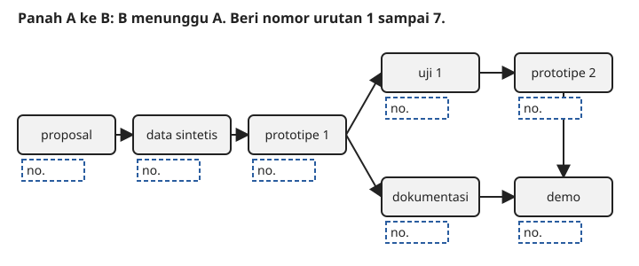

**Ingat dulu:** Tanpa melihat catatan, jawab. (1) Tulis tiga hal yang harus bisa kamu lakukan sebelum memakai AI pada tugas tingkat Kuning. (2) Kunci API sudah terlanjur masuk ke riwayat Git. Apa yang kamu lakukan, dan mengapa menghapus berkasnya tidak cukup?

(1) ______

(2) ______



`[Gambar: tujuh tugas dengan panah ketergantungan. Proposal ke data sintetis, data sintetis ke prototipe 1, prototipe 1 ke uji 1 dan ke dokumentasi, uji 1 ke prototipe 2, prototipe 2 ke demo, dokumentasi ke demo. Panah A ke B berarti B menunggu A. Tiap tugas punya kotak kosong no. untuk nomor urutan pengerjaan; diisi pada soal Prediksi bagian 2.]`

**Prediksi (bagian 2, pertemuan 4 dan 5):** Isi nomor urutan 1 sampai 7 pada gambar sehingga tiap tugas dikerjakan setelah semua tugas yang ditunggunya. Lalu jawab: tugas mana yang dapat dikerjakan anggota berbeda pada waktu yang sama? ______

**Prediksi (bagian 1):** Dua kalimat masalah untuk proyek yang sama. Mana yang dapat dijadikan uji, dan mengapa?

- A: "Laboratorium butuh sistem peminjaman alat yang bagus."
- B: "Asisten laboratorium ingin tahu, tiap pagi, alat mana yang terlambat dikembalikan dan berapa hari, dari catatan CSV yang sudah ada."

Jawabanku: ______

**Prediksi (bagian 3):** Tebak keluaran prototipe iterasi 1 untuk kasus peminjaman alat (tanggal hari ini 2026-03-20; data sintetis).

```python
import csv
import io
from datetime import date

DATA = """alat,kembali_rencana,kembali_nyata
mikroskop,2026-03-10,2026-03-09
sentrifus,2026-03-10,2026-03-14
pipet,2026-03-12,
"""


def hari_terlambat(rencana, nyata, hari_ini):
    batas = date.fromisoformat(rencana)
    akhir = date.fromisoformat(nyata) if nyata else hari_ini
    return max((akhir - batas).days, 0)


def ringkas(teks_csv, hari_ini):
    hasil = []
    for baris in csv.DictReader(io.StringIO(teks_csv)):
        telat = hari_terlambat(baris["kembali_rencana"], baris["kembali_nyata"], hari_ini)
        hasil.append((baris["alat"], telat))
    return hasil


for alat, telat in ringkas(DATA, date(2026, 3, 20)):
    print(alat, telat)
```

| Alat | Hari terlambat |
| --- | --- |
| mikroskop | |
| sentrifus | |
| pipet | |

**Lengkapi:** Isi bagian kosong.

```python setengah-jadi
selesai = {"proposal", "data sintetis"}
siap = [t for t, menunggu in tugas.items() if t not in selesai and menunggu ______ selesai]
print(siap)
```

```python setengah-jadi
def paling_terlambat(ringkasan):
    return max(ringkasan, key=lambda x: x[______])
```

```python setengah-jadi
from datetime import date

assert hari_terlambat("2026-03-10", "2026-03-10", date(2026, 3, 20)) == ______
```

Tulis tiga kriteria penerimaan untuk masalahmu sendiri dengan pola "Bila (keadaan), maka (hasil yang dapat diperiksa)":

1. ______
2. ______
3. ______

**Latihan:**

1. (Bagian 1) Perbaiki kalimat A hingga dapat diuji. AI: tanpa AI.
2. (Bagian 3) Mengapa tanggal hari ini dikirim sebagai argumen pada `hari_terlambat`, tidak dibaca dari jam komputer?
3. (Bagian 5) Proyek fiktif: tim menghitung "skor risiko" mahasiswa putus kuliah dari data sintetis dan memberi daftar nama ke dosen wali. Tulis dua hal yang dapat salah dan satu pagar pengaman. AI: tanpa AI.
4. (Bagian 5) Isi tabel refleksi untuk proyekmu, satu kalimat tiap kotak.

| Pertanyaan | Jawabanku |
| --- | --- |
| Siapa terdampak | |
| Data yang dipakai | |
| Risiko | |
| Pagar pengaman | |

5. (Bagian 4) Sebut enam isi dokumentasi proyek. Mengapa penilaian rekan bukan satu-satunya dasar nilai perorangan?

Ruang jawaban: ______

**Cek diri:**

- [ ] Aku dapat menulis kriteria penerimaan yang dapat diuji bersama pemangku kepentingan.
- [ ] Aku dapat memecah pekerjaan dan melihat ketergantungannya.
- [ ] Aku dapat menjawab pertanyaan etika proyekku.

**Catatan cetak (untuk dosen, tidak dicetak):** tiga halaman A4. Kunci dan petunjuk ada di modul `kul-u-301` bagian "Kunci dan petunjuk". Modul tidak memuat soal Parsons, sehingga bagian Susun dilewati. Lembar tidak memuat kolom nama, NIM, tanggal, atau nilai.
