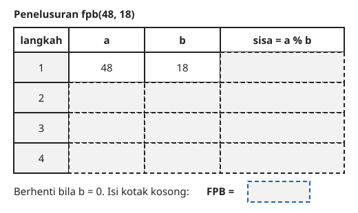

**Ingat dulu:** Tanpa melihat catatan, jawab.

1. Mengapa `n % 2 == 1` bukan cek ganjil yang aman untuk `n` negatif? ______
2. Mengapa pemeriksaan pembagi cukup sampai `sqrt(n)`? ______
3. Berapa `|A ∪ B|` bila `|A| = 6`, `|B| = 5`, dan `|A ∩ B| = 2`? ______



`[Gambar: tabel empat kolom (langkah, a, b, sisa = a % b) dan empat baris. Baris 1 sudah berisi a = 48 dan b = 18. Semua sel lain kosong. Di bawahnya ada kotak kosong "FPB =". Isi tabel dengan menelusuri fungsi fpb pada modul sampai b = 0.]`

**Prediksi:** Program banyak pembagi pada modul dijalankan dengan masukan `n = 36`. Tulis keluarannya, lalu sebutkan satu nilai `i` yang membuat cabang `i != n / i` bernilai salah. ______

**Lengkapi:** Isi bagian kosong pada perpangkatan modular.

```cpp setengah-jadi
long long pangkatMod(long long a, long long b, long long m) {
    long long hasil = ______ % m;
    a %= m;
    while (b > 0) {
        if (b & 1) {
            hasil = hasil * a % m;
        }
        a = ______ % m;
        b >>= ______;
    }
    return hasil;
}
```

Mengapa `hasil` diawali dengan bentuk itu, dan bukan langsung angka 1? ______

**Latihan:**

1. Tulis 360 sebagai hasil kali bilangan prima berpangkat, lalu hitung banyak pembagi positifnya dengan rumus `(e1 + 1)(e2 + 1)...`. ______
2. Hitung `1/6 + 1/3` sebagai `pembilang penyebut` dalam bentuk paling sederhana. Tulis juga FPB yang kamu pakai. ______
3. Anggap `A = {1, 2, 3, 4}` dan `B = {3, 4, 5}`. Tulis `|A ∪ B|`, `|A ∩ B|`, dan `|A \ B|`. ______
4. Program berikut dimaksudkan memeriksa apakah `n` (hingga 2.000.000.000) prima. Jelaskan dua masalahnya (satu soal batas tipe data, satu soal kasus kecil), perbaiki, lalu rancang satu masukan untuk masing-masing. ______

```cpp
#include <iostream>
using namespace std;

int main() {
    int n;
    cin >> n;
    bool prima = true;
    for (int i = 2; i * i <= n; i++) {
        if (n % i == 0) {
            prima = false;
        }
    }
    cout << (prima ? "prima" : "bukan prima") << "\n";
    return 0;
}
```

**Cek diri:**

- [ ] Aku bisa menghitung `(3 - 10) mod 7` agar hasilnya tidak negatif.
- [ ] Aku bisa menjelaskan mengapa perpangkatan cepat hanya perlu sekitar `log2(b)` langkah.
- [ ] Aku bisa menjelaskan mengapa saringan Eratosthenes mulai mencoret dari `i * i`.

**Catatan cetak (untuk guru, tidak dicetak):** dua halaman A4. Kunci dan penjelasan ada di modul `aritmetika` pada bagian "Keterbagian", "FPB dan KPK", "Perpangkatan modular", "Faktorisasi prima", "Himpunan", dan "Latihan 7". Lembar tidak memuat kolom nama, kelas, tanggal, atau nilai.
