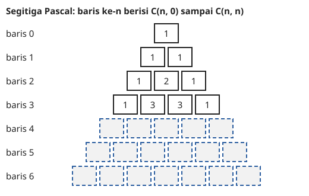

**Ingat dulu:** Tanpa melihat catatan, jawab.

1. Kapan memakai aturan jumlah dan kapan aturan kali? ______
2. Apa beda permutasi dan kombinasi? ______
3. Apa syarat agar rumus peluang "banyak yang memenuhi dibagi banyak semua" boleh dipakai? ______



`[Gambar: tujuh baris kotak membentuk segitiga Pascal, baris 0 sampai 6. Baris 0 sampai 3 sudah terisi (1; 1 1; 1 2 1; 1 3 3 1). Baris 4, 5, dan 6 kosong. Isi memakai C(n, k) = C(n-1, k-1) + C(n-1, k), lalu lingkari kotak yang bernilai C(6, 3).]`

**Prediksi:** Program peluang dua dadu pada modul dijalankan dengan masukan `6 6 7`. Tulis keluarannya. ______

**Lengkapi:** Isi bagian kosong pada program inklusi-eksklusi untuk tiga bilangan `d[0]`, `d[1]`, `d[2]`.

```cpp setengah-jadi
for (int mask = 1; mask < ______; mask++) {
    long long kpk = 1;
    int banyak = 0;
    for (int i = 0; i < 3; i++) {
        if ((mask >> i) & 1) {
            kpk = kpk / fpb(kpk, d[i]) * ______;
            banyak++;
        }
    }
    long long kelipatan = n / ______;
    if (banyak % 2 == ______) {
        total += kelipatan;
    } else {
        total -= kelipatan;
    }
}
```

Mengapa tanda berganti menurut `banyak`? ______

**Latihan:**

1. Sebuah laci berisi sangat banyak kaus kaki merah, biru, dan hijau. Berapa kaus kaki minimum yang harus diambil dalam gelap agar pasti ada sepasang berwarna sama? Berapa bila ingin pasti ada tiga berwarna sama? ______
2. Berapa banyak susunan huruf berbeda dari kata `KAKAK`? ______
3. Tunjukkan dengan pigeonhole bahwa di antara 5 bilangan bulat apa pun, ada dua bilangan yang selisihnya habis dibagi 4. Sebut apa objek dan apa kotaknya. ______
4. Barisan aritmetika memiliki suku pertama 5 dan beda 3. Tentukan suku ke-10 dan jumlah 10 suku pertama. ______
5. Program berikut dimaksudkan menghitung `1 + 2 + ... + n` untuk `n` hingga `10^9`, tetapi salah untuk `n` besar. Jelaskan penyebabnya, perbaiki, dan rancang satu masukan yang menunjukkan kesalahan itu. ______

```cpp
#include <iostream>
using namespace std;

int main() {
    int n;
    cin >> n;
    long long jumlah = n * (n + 1) / 2;
    cout << jumlah << "\n";
    return 0;
}
```

**Cek diri:**

- [ ] Aku bisa menjelaskan mengapa `C(n, k) = C(n-1, k-1) + C(n-1, k)`.
- [ ] Aku bisa menjelaskan mengapa irisan kelipatan 4 dan kelipatan 6 adalah kelipatan 12, bukan kelipatan 24.
- [ ] Aku bisa menyebut nilai terbesar `n` agar `F(n)` masih muat di `long long`.

**Catatan cetak (untuk guru, tidak dicetak):** dua halaman A4. Kunci dan penjelasan ada di modul `aturan-berhitung` pada bagian "Segitiga Pascal dan koefisien binomial", "Probabilitas", "Prinsip inklusi-eksklusi", dan "Latihan 6" serta "Latihan 7". Lembar tidak memuat kolom nama, kelas, tanggal, atau nilai.
