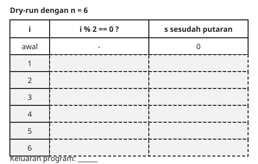

**Ingat dulu:** Tanpa melihat catatan, jawab.

1. Apa beda `7 / 2` dan `7.0 / 2`? ______
2. Berapa nilai `-7 % 3` dan mengapa? ______
3. Mengapa `long long x = a * b;` bisa salah walaupun `x` bertipe `long long`? ______



`[Gambar: tabel tiga kolom (i, i % 2 == 0 ?, s sesudah putaran). Baris "awal" berisi s = 0. Enam baris berikutnya untuk i = 1 sampai 6 kosong pada dua kolom terakhir. Di bawah tabel ada isian "Keluaran program". Isi tabel dengan menelusuri program pada Latihan 1.]`

**Prediksi:** Program berikut dijalankan. Tulis apa yang tercetak, lalu jelaskan mengapa. ______

```cpp
#include <iostream>
using namespace std;

void tambahSatu(int x) {
    x = x + 1;
}

int main() {
    int a = 5;
    tambahSatu(a);
    cout << a << "\n";
    return 0;
}
```

**Lengkapi:** Isi bagian kosong agar fungsi mengembalikan jumlah digit desimal `n`.

```cpp setengah-jadi
int jumlahDigit(int n) {
    int s = 0;
    while (n > ______) {
        s += n % ______;
        n /= ______;
    }
    return s;
}
```

Telusuri fungsi itu untuk `n = 90210`. Tulis nilai `n` dan `s` setiap putaran. ______

**Latihan:**

1. Telusuri program berikut untuk `n = 6` memakai tabel pada gambar. Tulis keluarannya. ______

```cpp
#include <iostream>
using namespace std;

int main() {
    int n;
    cin >> n;
    int s = 0;
    for (int i = 1; i <= n; i++) {
        if (i % 2 == 0) {
            s += i;
        } else {
            s -= 1;
        }
    }
    cout << s << "\n";
    return 0;
}
```

2. Ubah `S = 93784` detik menjadi `H J M D` (hari, jam, menit, detik) memakai `/` dan `%` secara berurutan. Tulis tiap langkah hitungannya. ______
3. Program berikut dimaksudkan mencetak hasil kali dua bilangan hingga 100.000, tetapi salah untuk beberapa masukan. Jelaskan penyebabnya, perbaiki, lalu rancang satu masukan yang menunjukkan kesalahan itu. ______

```cpp
#include <iostream>
using namespace std;

int main() {
    int a, b;
    cin >> a >> b;
    long long hasil = a * b;
    cout << hasil << "\n";
    return 0;
}
```

4. Untuk soal jumlah kuadrat `1^2 + 2^2 + ... + N^2` dengan `N` sampai 100.000, perkirakan nilai terbesar jawabannya, lalu pilih `int` atau `long long`. ______

**Cek diri:**

- [ ] Aku bisa menyebut kapan `int` tidak cukup dan apa yang kuganti.
- [ ] Aku bisa menyebut apa saja yang tidak boleh dicetak program yang dinilai judge otomatis.
- [ ] Aku bisa menelusuri program dengan tabel nilai variabel (dry-run).

**Catatan cetak (untuk guru, tidak dicetak):** dua halaman A4. Kunci dan penjelasan ada di modul `dasar-pemrograman` pada bagian "Operator dan ekspresi", "Fungsi, parameter, dan scope", "Integer overflow: int dan long long", "Format solusi", dan "Latihan 1" sampai "Latihan 6". Lembar tidak memuat kolom nama, kelas, tanggal, atau nilai.
