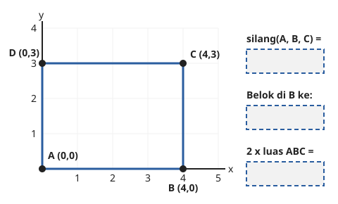

**Ingat dulu:** Tanpa melihat catatan, jawab.

1. Bagaimana membandingkan dua jarak tanpa memakai akar kuadrat? ______
2. Apa arti tanda positif, negatif, dan nol pada cross product tiga titik? ______
3. Apa beda garis, segmen, dan sinar? ______



`[Gambar: bidang koordinat dengan titik A (0,0), B (4,0), C (4,3), dan D (0,3) membentuk persegi panjang. Di kanan ada tiga kotak kosong: silang(A, B, C), arah belokan di B, dan dua kali luas segitiga ABC. Isi dengan rumus cross product pada modul.]`

**Prediksi:** Program `hampirSama` pada modul memakai `a = 0.1 + 0.2` dan `b = 0.3`, lalu mencetak `(a == b) << " " << hampirSama(a, b)`. Tulis dua angka yang tercetak. ______

**Lengkapi:** Isi bagian kosong pada fungsi cross product dan percabangannya.

```cpp setengah-jadi
long long silang(Titik a, Titik b, Titik c) {
    return (b.x - a.x) * (c.y - a.y) - (b.y - ______) * (c.x - ______);
}

if (s ______ 0) {
    cout << "KIRI" << "\n";
} else if (s ______ 0) {
    cout << "KANAN" << "\n";
} else {
    cout << "LURUS" << "\n";
}
```

**Susun:** Tabel rumus tali sepatu (shoelace) untuk persegi panjang ABCD pada gambar, titik berurutan A, B, C, D. Isi tabel, jumlahkan, lalu tulis luasnya.

| i | titik p[i] | titik p[i+1] | `p[i].x * p[i+1].y - p[i+1].x * p[i].y` |
| --- | --- | --- | --- |
| 0 | A | B | |
| 1 | B | C | |
| 2 | C | D | |
| 3 | D | A | |

Jumlah (dua kali luas): ______ Luas: ______

**Latihan:**

1. Mengapa `0.1 + 0.2 == 0.3` bernilai salah pada C++, dan bagaimana cara yang benar membandingkannya? ______
2. Sebuah soal meminta menentukan apakah titik `P` lebih dekat ke `A` atau ke `B`, dengan koordinat bulat sampai 10^9. Tulis cara membandingkannya tanpa `double`, dan jelaskan mengapa `double` dengan `sqrt` bisa salah pada jarak yang hampir sama. ______
3. Poligon berurutan berlawanan arah jarum jam: `(0,0)`, `(4,0)`, `(4,4)`, `(2,1)`, `(0,4)`. Apakah poligon ini konveks? Tunjukkan dengan cross product pada satu belokan. ______
4. Dari titik `(0,0)`, `(4,0)`, `(4,4)`, `(0,4)`, dan `(2,2)`, tentukan titik yang menjadi sudut convex hull dan titik yang berada di dalamnya. ______

**Cek diri:**

- [ ] Aku bisa menjelaskan hubungan nilai cross product dengan luas segitiga.
- [ ] Aku bisa menjelaskan mengapa persamaan garis `a x + b y = c` lebih aman daripada kemiringan.
- [ ] Aku bisa menyebut konversi 180 derajat ke radian dan satuan yang dipakai fungsi `<cmath>`.

**Catatan cetak (untuk guru, tidak dicetak):** dua halaman A4. Kunci dan penjelasan ada di modul `geometri-dasar` pada bagian "Bilangan pecahan dan presisi floating point", "Dot product dan cross product", "Bangun dasar", "Convex hull: definisi", dan "Latihan 6" serta "Latihan 8". Lembar tidak memuat kolom nama, kelas, tanggal, atau nilai.
