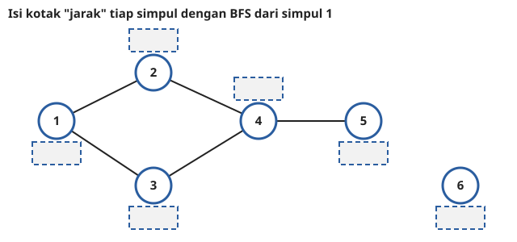

**Ingat dulu:** Tanpa melihat catatan, jawab.

1. Kapan memilih adjacency list dan kapan adjacency matrix? ______
2. Mengapa BFS menemukan jarak terpendek pada graph tak berbobot? ______
3. Berapa banyak sisi pada tree dengan `N` simpul, dan pada MST? ______



`[Gambar: graph tak berbobot dengan simpul 1 sampai 6 dan sisi 1-2, 1-3, 2-4, 3-4, 4-5. Simpul 6 tidak punya sisi. Setiap simpul punya kotak kosong untuk jarak (banyak sisi) dari simpul 1. Isi dengan menelusuri BFS memakai queue; untuk simpul yang tidak terjangkau, tulis nilai awal array jarak pada program.]`

**Prediksi:** Program DFS penghitung komponen pada modul dijalankan dengan `n = 6`, `m = 3`, dan sisi `1 2`, `2 3`, `4 5`. Tulis keluarannya. ______

**Lengkapi:** Isi bagian kosong pada BFS.

```cpp setengah-jadi
vector<int> jarak(n + 1, ______);
queue<int> q;
jarak[awal] = ______;
q.push(awal);
while (!q.empty()) {
    int v = q.front();
    q.______();
    for (int w : adj[v]) {
        if (jarak[w] == ______) {
            jarak[w] = jarak[v] + ______;
            q.push(w);
        }
    }
}
```

Mengapa simpul ditandai dikunjungi saat dimasukkan ke queue, bukan saat dikeluarkan? ______

**Latihan:**

1. Dijkstra dari simpul 1 pada graph tak berarah berbobot dengan 5 simpul dan sisi `1 2 4`, `1 3 1`, `3 2 2`, `2 4 1`, `3 4 5`. Tulis jarak ke simpul 1, 2, 3, 4, dan 5 (tulis -1 bila tidak terjangkau). ______
2. Kruskal pada 4 simpul dengan sisi `1 2 4`, `2 3 3`, `1 3 1`, `3 4 2`, `2 4 5`. Tulis urutan sisi menurut bobot, tandai sisi yang diambil dan yang dilewati, lalu tulis total bobot. ______
3. Tree 7 simpul berakar di 1 dengan sisi `1 2`, `1 3`, `2 4`, `2 5`, `3 6`, `3 7`. Tulis kedalaman simpul 4 dan simpul 7, `lca(4, 7)`, lalu jarak simpul 4 ke simpul 7 memakai rumus `kedalaman[u] + kedalaman[v] - 2 * kedalaman[lca(u, v)]`. ______
4. Pilih algoritma yang paling tepat, dan perkirakan jumlah operasinya: (a) `N = 100.000` simpul, `M = 200.000` jalan berbobot positif, satu simpul awal, jarak ke semua simpul; (b) `N = 300` simpul, jarak terpendek dari setiap simpul ke setiap simpul lain; (c) graph berarah dengan beberapa sisi negatif, `N = 1000`, `M = 5000`, apakah ada siklus negatif dari simpul 1. ______

**Cek diri:**

- [ ] Aku bisa menjelaskan mengapa Dijkstra tidak boleh dipakai bila ada sisi negatif.
- [ ] Aku bisa menjelaskan arti siklus negatif dan bagaimana Bellman-Ford mendeteksinya.
- [ ] Aku bisa menjelaskan mengapa perulangan `k` pada Floyd-Warshall harus paling luar.

**Catatan cetak (untuk guru, tidak dicetak):** dua halaman A4. Kunci dan penjelasan ada di modul `graph-tree` pada bagian "BFS dan shortest path tak berbobot", "DFS dan connectivity", "Dijkstra: shortest path berbobot nonnegatif", "LCA", "MST: Kruskal dan Prim", dan "Latihan 8". Lembar tidak memuat kolom nama, kelas, tanggal, atau nilai.
