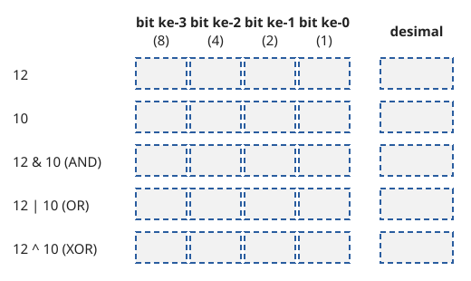

**Ingat dulu:** Tanpa melihat catatan, jawab.

1. Kapan `p → q` bernilai salah, dan bagaimana menuliskannya dengan `!` dan `||`? ______
2. Apa beda kontraposisi, konvers, dan invers? Mana yang ekuivalen dengan implikasi asalnya? ______
3. Mengapa "jika hujan maka jalan basah; jalan basah; jadi hujan" tidak sah? ______



`[Gambar: tabel dengan empat kolom bit (bit ke-3 bernilai 8, ke-2 bernilai 4, ke-1 bernilai 2, ke-0 bernilai 1) dan satu kolom desimal. Lima baris kosong berlabel 12, 10, 12 & 10 (AND), 12 | 10 (OR), dan 12 ^ 10 (XOR). Tulis 12 dan 10 dalam biner dulu, lalu isi tiga baris hasil per posisi bit, lalu tulis nilai desimalnya.]`

**Prediksi:** Tulis nilai `1 && 2` dan nilai `1 & 2`. Mengapa keduanya berbeda? ______

**Lengkapi:** Isi bagian kosong agar fungsi menghitung banyak bit 1.

```cpp setengah-jadi
int banyakBitSatu(unsigned long long x) {
    int hitung = 0;
    while (x > ______) {
        x &= x ______ 1;
        hitung++;
    }
    return hitung;
}
```

Telusuri fungsi itu untuk `x = 13` (biner `1101`). Tulis `x` dalam biner pada tiap putaran. ______

**Latihan:**

1. Isi tabel kebenaran untuk `(p XOR q) ↔ ¬(p ↔ q)`. Apa yang kamu simpulkan dari kolom terakhir?

| p | q | p XOR q | p ↔ q | ¬(p ↔ q) | (p XOR q) ↔ ¬(p ↔ q) |
| --- | --- | --- | --- | --- | --- |
| 0 | 0 | | | | |
| 0 | 1 | | | | |
| 1 | 0 | | | | |
| 1 | 1 | | | | |

Kesimpulan: ______

2. Tentukan sah atau tidak sah, dan sebut namanya bila cocok dengan modus ponens atau modus tollens. ______
   - Jika sebuah bilangan habis dibagi 6 maka bilangan itu genap. Bilangan 14 genap. Jadi 14 habis dibagi 6.
   - Jika sebuah bilangan habis dibagi 6 maka bilangan itu genap. Bilangan 9 tidak genap. Jadi 9 tidak habis dibagi 6.
3. Tulis kontraposisi dan konvers dari "jika n prima dan n > 2 maka n ganjil". Mana yang selalu benar? ______
4. Program mencetak `(x & y)`, `(x | y)`, `(x ^ y)`, `(x << 2)`, dan `(y >> 1)` untuk masukan `12 10`. Gunakan tabel pada gambar, lalu tulis kelima keluarannya. ______
5. Program berikut dimaksudkan menghitung banyak bit 1 pada `n` (hingga 10^18), tetapi hasilnya salah atau tidak dapat diandalkan untuk bilangan besar. Jelaskan penyebabnya, perbaiki, lalu rancang satu masukan yang menunjukkan masalahnya. ______

```cpp
#include <iostream>
using namespace std;

int main() {
    long long n;
    cin >> n;
    int hitung = 0;
    for (int i = 0; i < 60; i++) {
        if (n & (1 << i)) {
            hitung++;
        }
    }
    cout << hitung << "\n";
    return 0;
}
```

**Cek diri:**

- [ ] Aku bisa menjelaskan mengapa `x & 1 == 0` bukan pengecekan genap yang benar.
- [ ] Aku bisa menjelaskan mengapa `1 << 40` tidak boleh dipakai pada `int` dan menyebut gantinya.
- [ ] Aku bisa menjelaskan mengapa XOR seluruh daftar menemukan nilai yang muncul sekali.

**Catatan cetak (untuk guru, tidak dicetak):** dua halaman A4. Kunci dan penjelasan ada di modul `logika-bitwise` pada bagian "Implikasi, biimplikasi, dan XOR", "Modus ponens dan modus tollens", "Operasi bit", "Mask: mengecek, menyalakan, mematikan, dan membalik bit", "Latihan 5", dan "Latihan 7". Lembar tidak memuat kolom nama, kelas, tanggal, atau nilai.
