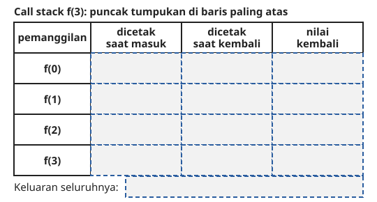

**Ingat dulu:** Tanpa melihat catatan, jawab.

1. Apa dua bagian yang wajib ada pada fungsi rekursif? ______
2. Apa yang terjadi bila kasus dasar tidak pernah tercapai? ______
3. Mengapa `fib` rekursif sederhana lambat, padahal benar? ______



`[Gambar: tabel call stack untuk f(3), empat baris f(0), f(1), f(2), f(3) dengan puncak tumpukan di baris paling atas. Tiga kolom kosong: yang dicetak saat masuk, yang dicetak saat kembali, dan nilai kembali. Di bawahnya ada isian "Keluaran seluruhnya". Isi dengan menelusuri program pada Latihan 1.]`

**Prediksi:** Tulis keluaran `turun(3)` pada modul, yaitu prosedur yang mencetak `n` sebelum dan sesudah pemanggilan rekursif `turun(n - 1)`. Mengapa angka dicetak dua kali dengan urutan terbalik? ______

**Lengkapi:** Isi bagian kosong pada pangkat cepat rekursif.

```cpp setengah-jadi
long long pangkat(long long a, int n) {
    if (n == ______) {
        return 1;
    }
    if (n % 2 == 0) {
        long long setengah = pangkat(a, n / ______);
        return setengah * ______;
    }
    return a * pangkat(a, n - ______);
}
```

Mengapa hasil `pangkat(a, n / 2)` disimpan dalam variabel `setengah`? ______

**Latihan:**

1. Telusuri program berikut untuk `f(3)`. Isi tabel pada gambar dan tulis keluarannya. ______

```cpp
#include <iostream>
using namespace std;

int f(int n) {
    if (n == 0) {
        return 1;
    }
    cout << n << " ";
    int hasil = n * f(n - 1);
    cout << hasil << " ";
    return hasil;
}

int main() {
    f(3);
    cout << "\n";
    return 0;
}
```

2. Untuk fungsi `cek(s, i, j)` pemeriksa palindrom: tulis kasus dasar bila `i >= j`, dan kasus rekursifnya. ______
3. Tulis semua string biner panjang 3 yang tidak memuat dua karakter `1` bersebelahan, lalu hitung banyaknya. ______
4. Dari bilangan 1, 2, 3, 4, tulis semua himpunan bagian (berdasarkan posisi) yang berjumlah tepat 5. ______
5. Gambar pohon rekursi `fib(5)` dan hitung banyak pemanggilannya. ______

**Cek diri:**

- [ ] Aku bisa menyebut tiga langkah divide-and-conquer.
- [ ] Aku bisa menjelaskan mengapa pada backtracking pilihan harus dibatalkan setelah pemanggilan rekursif.
- [ ] Aku bisa menjelaskan apa itu pruning dan mengapa membuat N-Queens lebih cepat.

**Catatan cetak (untuk guru, tidak dicetak):** dua halaman A4. Kunci dan penjelasan ada di modul `rekursi` pada bagian "Call stack", "Fungsi rekursif dan prosedur rekursif", "Divide-and-conquer", "Backtracking", "Latihan 5", dan "Latihan 6". Lembar tidak memuat kolom nama, kelas, tanggal, atau nilai.
