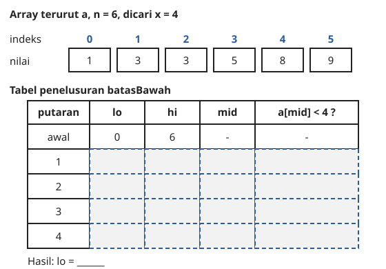

**Ingat dulu:** Tanpa melihat catatan, jawab.

1. Apa syarat agar binary search boleh dipakai? ______
2. Apa invarian pada binary search `batasBawah` di modul? ______
3. Mengapa insertion sort cepat pada data yang hampir terurut? ______



`[Gambar: array a berisi 1, 3, 3, 5, 8, 9 dengan indeks 0 sampai 5, lalu tabel penelusuran dengan kolom putaran, lo, hi, mid, dan "a[mid] < 4 ?". Baris awal berisi lo = 0 dan hi = 6; empat baris putaran kosong. Di bawahnya ada isian "Hasil: lo". Isi dengan menelusuri fungsi batasBawah dari modul untuk x = 4.]`

**Prediksi:** Array `5 1 4 2 8` diurutkan dengan bubble sort pada modul. Tulis isi array setelah putaran pertama (`i = 0`) selesai. ______

**Lengkapi:** Isi bagian kosong pada `batasBawah`.

```cpp setengah-jadi
int lo = 0, hi = ______;
while (lo ______ hi) {
    int mid = lo + (hi - lo) / ______;
    if (a[mid] < x) {
        lo = ______;
    } else {
        hi = ______;
    }
}
return lo;
```

Mengapa `mid` ditulis `lo + (hi - lo) / 2`, bukan `(lo + hi) / 2`? ______

**Latihan:**

1. Telusuri insertion sort pada masukan `5 2 4 6 1 3`. Tulis isi array setelah setiap nilai `i`, lalu hitung total pergeseran (jumlah eksekusi `a[j + 1] = a[j]`). ______

| i | isi array sesudah | pergeseran |
| --- | --- | --- |
| 1 | | |
| 2 | | |
| 3 | | |
| 4 | | |
| 5 | | |

Total pergeseran: ______ Cocokkan dengan banyaknya inversi pada array awal: ______

2. Tulis semua pasangan posisi `i < j` dengan `a[i] > a[j]` pada array `2 4 1 3`. ______
3. Dua larik terurut `1 4 7` dan `2 3 5 8` digabung dengan dua penunjuk seperti fungsi `gabung`. Tulis hasil gabungan dan urutan elemen yang diambil. ______
4. Fungsi berikut dimaksudkan mencari indeks pertama elemen yang nilainya paling sedikit `x` pada array terurut, tetapi tidak pernah berhenti untuk beberapa masukan. Temukan masukan yang menyebabkannya (petunjuk dari modul: `n = 2`), jelaskan penyebabnya, lalu perbaiki. ______

```cpp
int cari(const int a[], int n, int x) {
    int lo = 0, hi = n - 1;
    while (lo < hi) {
        int mid = (lo + hi) / 2;
        if (a[mid] < x) {
            lo = mid;
        } else {
            hi = mid;
        }
    }
    return lo;
}
```

**Cek diri:**

- [ ] Aku bisa menjelaskan mengapa merge sort selalu O(n log n) dan apa harganya.
- [ ] Aku bisa menjelaskan kapan quicksort menjadi O(n^2) dan bagaimana menghindarinya.
- [ ] Aku bisa menjelaskan arti sort yang stabil dan kapan itu penting.

**Catatan cetak (untuk guru, tidak dicetak):** dua halaman A4. Kunci dan penjelasan ada di modul `search-sort` pada bagian "Binary search", "Bubble sort", "Insertion sort", "Merge sort", "Latihan 3", dan "Latihan 6". Lembar tidak memuat kolom nama, kelas, tanggal, atau nilai.
