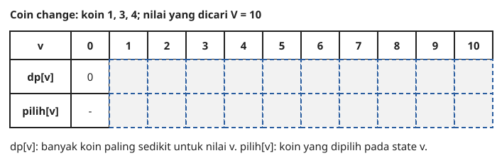

**Ingat dulu:** Tanpa melihat catatan, jawab.

1. Bagaimana memperkirakan apakah sebuah pendekatan cukup cepat dari batasan soal? ______
2. Apa itu pruning, dan bagaimana memastikan pruning tidak membuang solusi optimal? ______
3. Apa saja yang harus kamu tulis sebelum menulis DP? ______



`[Gambar: tabel dengan kolom v = 0 sampai 10 dan dua baris, dp[v] dan pilih[v]. Hanya dp[0] yang terisi (0). Semua sel lain kosong. Isi dp[v] (banyak koin paling sedikit untuk nilai v) dan pilih[v] (koin yang dipilih) untuk koin 1, 3, dan 4 memakai transisi dp[v] = min(dp[v - c] + 1).]`

**Prediksi:** Koin bernilai 1, 3, dan 4 dengan target 6. Berapa koin yang dipakai greedy (selalu ambil koin terbesar yang masih muat), dan berapa koin minimum sebenarnya? ______

**Lengkapi:** Isi bagian kosong pada DP coin change.

```cpp setengah-jadi
dp[______] = 0;
for (int v = 1; v <= V; v++) {
    for (int c : koin) {
        if (c <= v && dp[v - c] != TAK_TERJANGKAU && dp[v - c] + ______ < dp[v]) {
            dp[v] = dp[v - c] + 1;
            pilih[v] = ______;
        }
    }
}
```

Mengapa nilai yang tidak terjangkau diberi angka sangat besar dan diperiksa terpisah, bukan dijumlahkan begitu saja? ______

**Latihan:**

1. Untuk koin 1, 3, 4 dan target 10, isi tabel pada gambar. Lalu tulis banyak koin yang dipakai greedy dan susunannya, serta banyak koin minimum sebenarnya dan susunannya. ______
2. Lima kegiatan (mulai, selesai): (1,3), (2,5), (3,6), (5,7), (6,9). Urutkan menurut waktu selesai, lalu tulis kegiatan yang dipilih greedy. Kegiatan yang selesai tepat saat kegiatan lain mulai boleh dipilih bersama. ______
3. Menaiki tangga `N = 5` anak tangga, tiap langkah naik 1 atau 2. Tulis state `dp[i]`, transisinya, kasus dasarnya, lalu nilai `dp[1]` sampai `dp[5]`. ______
4. Untuk tiap situasi, tulis kompleksitas tertinggi yang masih layak dan satu pendekatan yang cocok: ______
   - Pilih himpunan bagian dari `n = 18` bilangan sehingga jumlahnya mendekati sebuah target.
   - Urutkan `n = 100.000` kegiatan dan pilih sebanyak mungkin yang tidak bertumpukan.
   - Hitung banyak cara mencapai sebuah nilai dengan `n = 2.000` jenis langkah dan nilai sampai 2.000.
   - Cari bilangan terkecil yang memenuhi syarat monoton pada rentang sampai 10^18.

**Cek diri:**

- [ ] Aku bisa menjelaskan apa yang membuat greedy valid dan bagaimana menolaknya dengan contoh tandingan.
- [ ] Aku bisa menjelaskan beda memoization dan tabulation.
- [ ] Aku bisa menjelaskan mengapa knapsack satu dimensi mengisi kapasitas dari besar ke kecil.

**Catatan cetak (untuk guru, tidak dicetak):** dua halaman A4. Kunci dan penjelasan ada di modul `strategi-problem-solving` pada bagian "Memilih strategi dari batasan soal", "Greedy", "Dynamic programming", "Coin change dan rekonstruksi", "Latihan 1", dan "Latihan 7". Lembar tidak memuat kolom nama, kelas, tanggal, atau nilai.
