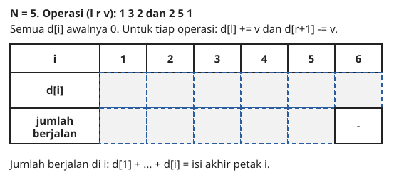

**Ingat dulu:** Tanpa melihat catatan, jawab.

1. Mengapa `d[r+1] -= v` diperlukan pada difference array? ______
2. Apa yang diwakili `p[r] - p[l-1]`, dan mengapa indeks dimulai dari 1? ______
3. Apa beda stack, queue, dan priority_queue dalam urutan keluarnya elemen? ______



`[Gambar: tabel dengan indeks i = 1 sampai 6 dan dua baris, d[i] dan jumlah berjalan. Semua sel kosong; kolom 6 pada baris jumlah berjalan bertanda strip. Di atas tabel tertulis N = 5 dan dua operasi (l r v): 1 3 2 dan 2 5 1. Isi d[i] untuk setiap operasi, lalu jumlah berjalan untuk isi akhir tiap petak.]`

**Prediksi:** Pada program prefix sum, `n = 5`, elemen `3 1 4 1 5`, dan pertanyaan `2 4`. Tulis isi `p[0]` sampai `p[5]`, lalu jawaban pertanyaan itu. ______

**Lengkapi:** Isi bagian kosong pada operasi `gabung` DSU.

```cpp setengah-jadi
bool gabung(int a, int b) {
    a = ______(a);
    b = ______(b);
    if (a == b) {
        return ______;
    }
    if (ukuran[a] < ukuran[b]) {
        swap(a, b);
    }
    induk[b] = ______;
    ukuran[a] += ukuran[b];
    return true;
}
```

Mengapa himpunan kecil digantungkan ke himpunan besar? ______

**Latihan:**

1. Isi tabel pada gambar. Tulis isi akhir petak 1 sampai 5. ______
2. Telusuri program kurung seimbang untuk `([]{})` dan untuk `(]`. Tulis isi stack setelah tiap karakter dan hasil akhirnya (`SEIMBANG` atau `TIDAK`). ______
3. Tali berpanjang `4 3 2 6`. Menyambung dua tali berpanjang `x` dan `y` berbiaya `x + y`. Selalu sambung dua tali terpendek. Tulis urutan penyambungan dan biaya totalnya. ______
4. Lima pulau, awalnya tanpa jembatan. Jembatan dibangun berurutan: `1 2`, `3 4`, `2 1`, `2 3`. Setelah tiap jembatan, tulis banyak kelompok pulau yang saling terhubung (kurangi hitungan hanya bila `gabung` mengembalikan `true`). ______
5. Pilih struktur data yang paling tepat dan beri alasan singkat (operasi dan kompleksitas): ______
   - `N = 200.000` suhu harian, `Q = 200.000` pertanyaan suhu terendah dari hari `l` sampai `r`, suhu tidak pernah berubah.
   - Sama seperti di atas, tetapi di antara pertanyaan ada perubahan suhu pada satu hari.
   - Bilangan datang satu per satu; setiap perintah "ambil" mengeluarkan bilangan terkecil yang belum diambil.
   - Memeriksa apakah sebuah kata pernah muncul di antara `100.000` kata.

**Cek diri:**

- [ ] Aku bisa menjelaskan kapan two pointers valid dan mengapa elemen negatif merusaknya.
- [ ] Aku bisa menyebut dua optimisasi DSU dan apa yang tidak bisa dilakukan DSU.
- [ ] Aku bisa menyebut elemen netral untuk jumlah, minimum, dan maksimum.

**Catatan cetak (untuk guru, tidak dicetak):** dua halaman A4. Kunci dan penjelasan ada di modul `struktur-data` pada bagian "Prefix sum", "Difference array", "Stack dan queue", "Binary heap dan priority_queue", "DSU (Disjoint Set Union)", "Latihan 2", "Latihan 5", dan "Latihan 8". Lembar tidak memuat kolom nama, kelas, tanggal, atau nilai.
