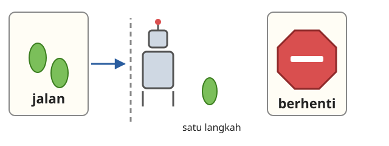

**Ingat dulu:** Tanpa melihat apa pun, gambar satu permainan "ikuti perintah" yang kamu ingat.

`[Gambar: kotak kosong di bagian atas kertas dengan gambar kecil kepala berpikir di sudutnya.]`

**Contoh:**

`[Gambar: di kiri, kartu "jalan" dengan telapak kaki. Panah menunjuk ke robot kotak di garis, lalu satu jejak kaki di depannya. Di kanan, kartu "berhenti" dengan segi delapan merah.]`

Perintah: **jalan**. Robot: **satu langkah**.

**Bandingkan:**

`[Gambar: dua kolom berdampingan. Kolom A: kartu "jalan satu langkah", robot melangkah satu langkah. Kolom B: kartu "ke sana sebentar", robot berdiri bingung dengan tanda tanya di atas kepalanya.]`

- Apa yang **sama**? Gambar atau tunjuk.
- Apa yang **beda**? Gambar atau tunjuk.
- Mana yang lebih **jelas**? Lingkari A atau B.

**Coba:** Beri robot temanmu satu perintah. Lalu gambar satu langkahnya.

`[Gambar: dua kotak kosong berurutan dengan panah di antaranya; kotak pertama bertanda "perintah", kotak kedua bertanda "langkah robot".]`

**Ceritakan** ke temanmu: perintah apa yang paling jelas?

**Catatan cetak (untuk guru, tidak dicetak):** satu lembar per murid, kertas A4. Lembar tidak memuat kolom nama, kelompok, tanggal, atau nilai; penandaan kertas diurus guru di sekolah.
