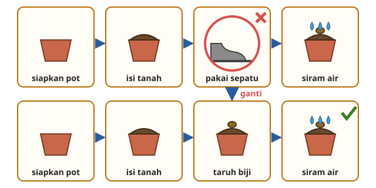

**Ingat dulu:** Tanpa melihat apa pun, gambar satu perintah satu langkah yang jelas untuk robot.

`[Gambar: kotak kosong di atas kertas dengan gambar kecil kepala berpikir di sudutnya.]`

**Contoh:** Petunjuk menanam biji. Langkah 3 salah. Ganti, lalu jalankan lagi dari awal.

`[Gambar: dua baris, tiap baris empat kartu. Baris atas: siapkan pot, isi tanah, sepatu dengan tanda silang merah dan lingkaran, siram air. Panah ke bawah bertuliskan "ganti". Baris bawah: siapkan pot, isi tanah, taruh biji, siram air, dengan tanda centang.]`

**Bandingkan:**

`[Gambar: dua baris kartu berdampingan. Baris A: siapkan pot, isi tanah, taruh biji, siram air. Baris B: sama, tetapi kartu ketiga bergambar sepatu.]`

- Apa yang **sama**? Tunjuk.
- Apa yang **beda**? Tunjuk.

**Coba:** Petunjuk cuci tangan. **Lingkari** langkah yang salah.

basahi tangan, pakai sabun, pakai topi, bilas, keringkan

`[Gambar: lima kartu berurutan: keran, gelembung sabun, topi, air mengalir, handuk.]`

Sekarang sendiri: petunjuk menyiram tanaman. Lingkari langkah yang salah, lalu gambar penggantinya.

ambil botol berisi air, tuang air pelan ke tanah, makan bekal, taruh botol

`[Gambar: empat kartu berurutan: botol air, air dituang ke pot, kotak bekal, botol di rak. Di bawah kartu ketiga ada satu kotak kosong untuk pengganti.]`

Jalankan lagi dari awal dengan temanmu. Jalan? Lingkari: ya / belum.

**Ceritakan** ke temanmu: bagaimana kamu menemukan langkah yang salah?

**Catatan cetak (untuk guru, tidak dicetak):** satu lembar per murid, kertas A4. Lembar tidak memuat kolom nama, kelompok, tanggal, atau nilai; penandaan kertas diurus guru di sekolah.
