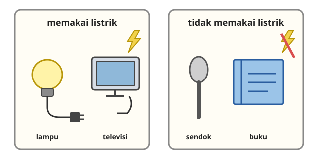

**Ingat dulu:** Tanpa melihat apa pun, gambar satu langkah dari petunjuk yang pernah kamu perbaiki.

`[Gambar: kotak kosong di atas kertas dengan gambar kecil kepala berpikir di sudutnya.]`

**Contoh:** Lampu memakai listrik. Ia punya kabel dan colokan. Sendok tidak memakai listrik.

`[Gambar: dua kotak berdampingan. Kotak kiri bergambar petir kecil dan berisi lampu dan televisi dengan kabel. Kotak kanan bergambar petir dicoret dan berisi sendok dan buku.]`

**Bandingkan:**

`[Gambar: dua gambar berdampingan. A: kipas angin dengan kabel dan colokan. B: kipas kertas dipegang tangan.]`

- Apa yang **sama**? Tunjuk.
- Apa yang **beda**? Tunjuk.

**Coba:** Tarik garis dari gambar ke kotak yang cocok: kulkas.

`[Gambar: gambar kulkas di tengah, dengan dua kotak di kiri (petir) dan kanan (tangan) untuk dihubungkan.]`

Sekarang sendiri: tarik garis untuk **bola**, **televisi**, dan **sepatu**.

`[Gambar: tiga gambar berderet (bola, televisi, sepatu) dengan dua kotak, memakai listrik dan tidak memakai listrik, di bawahnya.]`

**Aturan aman:** Kami tidak menyentuh stopkontak. Kami memanggil orang dewasa.

`[Gambar: tangan dengan tanda silang di depan lubang stopkontak, dan gambar kecil orang dewasa tanpa wajah rinci melambai.]`

**Ceritakan** ke temanmu: apa yang kamu lihat pada alat yang memakai listrik?

**Catatan cetak (untuk guru, tidak dicetak):** satu lembar per murid, kertas A4; gambar alat dicetak cukup besar. Lembar tidak memuat kolom nama, kelompok, tanggal, atau nilai; penandaan kertas diurus guru di sekolah.
