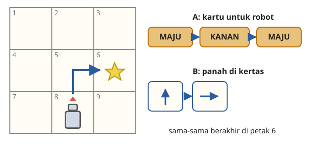

**Ingat dulu:** Tanpa melihat apa pun, gambar panah ke atas dan panah ke kanan, atau tunjuk ke arah kananmu.

`[Gambar: kotak kosong di atas kertas dengan gambar kecil kepala berpikir di sudutnya.]`

**Contoh:** Robot mulai di petak 8. Ia menghadap atas. Bintang di petak 6. Kartu: MAJU, KANAN, MAJU.

`[Gambar: kisi 3x3 bernomor 1 sampai 9, baris atas 1 2 3. Robot di petak 8 menghadap atas, bintang di petak 6; panah naik ke petak 5 lalu ke kanan. Di kanan: kartu MAJU, KANAN, MAJU dan dua panah, atas dan kanan.]`

**Bandingkan:**

| A: kartu untuk robot | B: panah di kertas |
| --- | --- |
| MAJU, KANAN, MAJU | atas, kanan |
| petak 6 | petak ____ |

- Apa yang **sama**? Tunjuk.
- Apa yang **beda**? Tunjuk.

**Coba:** Robot mulai di petak 8, tujuan petak 1. Tempel kartu yang kurang.

MAJU, MAJU, ____, MAJU

`[Gambar: kisi 3x3, robot di petak 8, bintang di petak 1; empat kotak berurutan, kotak ketiga kosong.]`

Sekarang sendiri: tujuan **petak 9**. Tempel kartumu.

`[Gambar: kisi 3x3, robot di petak 8 menghadap atas, bintang di petak 9; tiga kotak kosong berurutan.]`

Tukar dengan temanmu. Sampai di petak 9? Lingkari: ya / belum.

**Ceritakan** ke temanmu: apa bedanya kartu KANAN dengan panah kanan?

**Catatan cetak (untuk guru, tidak dicetak):** satu lembar per murid, kertas A4; siapkan kartu untuk digunting dan ditempel. Lembar tidak memuat kolom nama, kelompok, tanggal, atau nilai; penandaan kertas diurus guru di sekolah.
