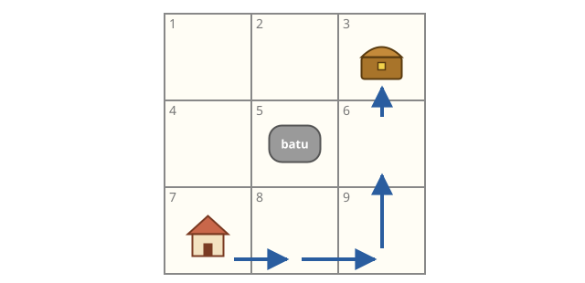

**Ingat dulu:** Tanpa melihat apa pun, gambar satu panah dan tunjuk petak yang ditunjuknya.

`[Gambar: kotak kosong di atas kertas dengan gambar kecil kepala berpikir di sudutnya.]`

**Contoh:** Rumah di petak 7. Harta di petak 3. Batu di petak 5. Panah: kanan, kanan, atas, atas.

`[Gambar: kisi 3x3 bernomor 1 sampai 9, baris atas 1 2 3. Rumah di petak 7, kotak harta di petak 3, batu di petak 5. Empat panah biru: 7 ke 8, 8 ke 9, 9 ke 6, 6 ke 3.]`

**Bandingkan:**

| A | B |
| --- | --- |
| atas, atas, kanan, kanan | atas, kanan, atas, kanan |
| lewat 4, 1, 2, 3 | lewat 4, 5, 2, 3 |

- Apa yang **sama**? Tunjuk.
- Apa yang **beda**? Tunjuk.

**Coba:** Rumah di petak 9. Harta di petak 4. Batu di petak 5. Gambar panah yang kurang.

kiri, ____, atas

`[Gambar: kisi 3x3 bernomor, rumah di petak 9, harta di petak 4, batu di petak 5; panah 9 ke 8 sudah digambar.]`

Sekarang kelompokmu: pilih rumah, harta, dan satu batu. Gambar jalurmu dengan panah.

`[Gambar: kisi 3x3 bernomor kosong.]`

Teman menjalankannya dengan pion. Sampai di harta? Lingkari: ya / belum.

**Ceritakan** ke temanmu: apa yang kamu periksa sebelum memberikan petamu?

**Catatan cetak (untuk guru, tidak dicetak):** satu lembar per murid, kertas A4; kisi dicetak cukup besar. Lembar tidak memuat kolom nama, kelompok, tanggal, atau nilai; penandaan kertas diurus guru di sekolah.
