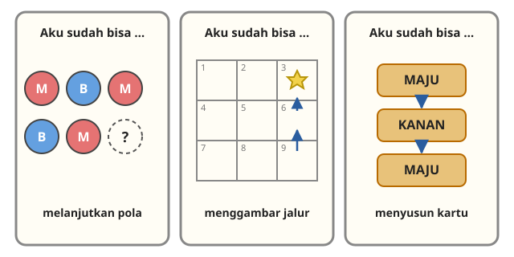

**Ingat dulu:** Tanpa melihat apa pun, tunjukkan satu hal yang kamu pelajari sejak minggu pertama.

`[Gambar: kotak kosong di atas kertas dengan gambar kecil kepala berpikir di sudutnya.]`

**Contoh:** "Aku sudah bisa melanjutkan pola." Merah, biru, merah, biru, merah, ...

`[Gambar: tiga bingkai berdampingan. Kiri: lingkaran merah, biru, merah, biru, merah bertulisan M atau B, lalu satu kosong. Tengah: kisi 3x3 mungil dengan dua panah. Kanan: tiga kartu MAJU, KANAN, MAJU.]`

**Bandingkan:**

`[Gambar: A, pola merah, biru, merah, biru. B, kisi 3x3 dengan panah dari petak 9 ke petak 6.]`

- Apa yang **sama**? Tunjuk.
- Apa yang **beda**? Tunjuk.

**Coba:** Lanjutkan pola. Gambar kartu yang kosong.

merah, merah, biru, merah, merah, ____

`[Gambar: lima kartu M, M, B, M, M, lalu satu kotak kosong.]`

Sekarang sendiri: robot di **petak 8**, menghadap atas. Kartu: MAJU, KANAN, MAJU. Robot berakhir di petak ____.

`[Gambar: kisi 3x3 bernomor, robot di petak 8 menghadap atas; tiga kartu MAJU, KANAN, MAJU.]`

Gambar jalur dari **petak 9 ke petak 1** dengan panah.

`[Gambar: kisi 3x3 bernomor, rumah di petak 9, bintang di petak 1.]`

**Gambarlah:** Aku sudah bisa ...

`[Gambar: bingkai besar kosong.]`

**Ceritakan** ke temanmu: satu hal yang sudah bisa, dan satu hal yang masih ingin kamu latih.

**Catatan cetak (untuk guru, tidak dicetak):** satu lembar per murid, kertas A4; tulis huruf M dan B pada kartu pola untuk murid yang sulit membedakan warna. Lembar tidak memuat kolom nama, kelompok, tanggal, atau nilai; penandaan kertas diurus guru di sekolah.
