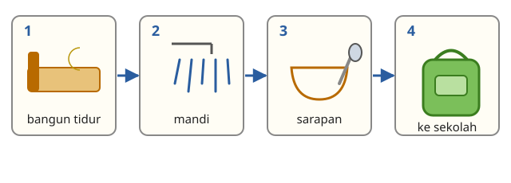

**Ingat dulu:** Tanpa melihat apa pun, tunjuk atau gambar satu perintah satu langkah untuk robot.

`[Gambar: kotak kosong di atas kertas dengan gambar kecil kepala berpikir di sudutnya.]`

**Contoh:** Pagi hari. Pertama, kedua, ketiga, keempat.

`[Gambar: empat kartu berurutan dengan panah dan angka 1 sampai 4. Kartu 1: tempat tidur dan bulan sabit. Kartu 2: pancuran air. Kartu 3: mangkuk dan sendok. Kartu 4: tas sekolah.]`

**Bandingkan:**

`[Gambar: dua baris kartu berdampingan. Baris A: bangun, mandi, sarapan, berangkat. Baris B: bangun, sarapan, mandi, berangkat. Kartu pertama dan terakhir diberi bingkai yang sama.]`

- Apa yang **sama**? Tunjuk.
- Apa yang **beda**? Tunjuk.

**Coba:** Tempel atau gambar empat kartu pagi dengan urutanmu.

`[Gambar: empat kotak kosong berurutan, bertanda 1, 2, 3, dan 4, dengan panah di antaranya.]`

**Ceritakan** ke temanmu: pertama apa? Terakhir apa?

**Catatan cetak (untuk guru, tidak dicetak):** satu lembar per murid, kertas A4; siapkan empat kartu untuk digunting dan ditempel. Lembar tidak memuat kolom nama, kelompok, tanggal, atau nilai; penandaan kertas diurus guru di sekolah.
