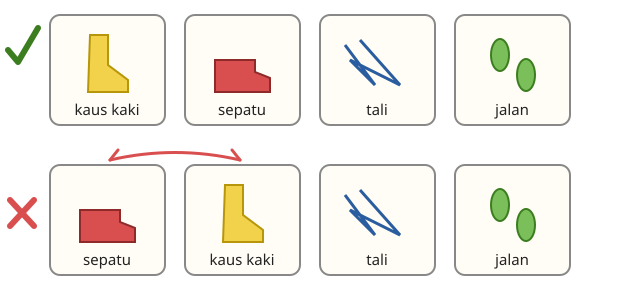

**Ingat dulu:** Tanpa melihat apa pun, gambar kegiatan pagimu yang pertama.

`[Gambar: kotak kosong di atas kertas dengan gambar kecil kepala berpikir di sudutnya.]`

**Contoh:** Urutan benar dan urutan salah. Kartunya sama.

`[Gambar: dua baris, tiap baris empat kartu. Baris atas dengan tanda centang hijau: kaus kaki, sepatu, tali, jalan. Baris bawah dengan tanda silang merah: sepatu, kaus kaki, tali, jalan; dua kartu pertama diberi panah bolak-balik.]`

**Bandingkan:**

- Apa yang **sama**? Tunjuk.
- Apa yang **beda**? Tunjuk.

**Coba:** Dua kartu tertukar. **Lingkari** keduanya.

`[Gambar: satu baris empat kartu bergambar: 1 ambil kertas, 2 menggambar, 3 ambil krayon, 4 pajang gambar. Kartu 2 dan 3 tertukar.]`

Sekarang tulis angka **1, 2, 3, 4** pada urutan yang benar.

`[Gambar: empat kotak kosong berurutan di bawah baris kartu, dengan panah di antaranya.]`

**Ceritakan** ke temanmu: bagaimana kamu tahu dua kartu itu tertukar?

**Catatan cetak (untuk guru, tidak dicetak):** satu lembar per murid, kertas A4; empat kartu pada lembar bisa digunting dan ditempel. Lembar tidak memuat kolom nama, kelompok, tanggal, atau nilai; penandaan kertas diurus guru di sekolah.
