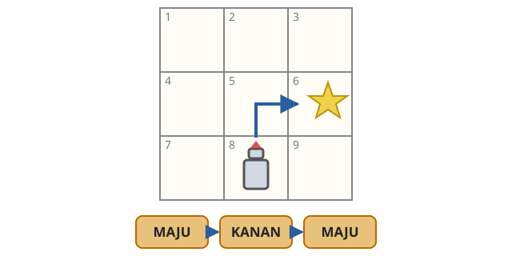

**Ingat dulu:** Tanpa melihat apa pun, gambar dua kartu yang tertukar pada minggu lalu.

`[Gambar: dua kotak kosong berdampingan di atas kertas dengan gambar kecil kepala berpikir di sudutnya.]`

**Contoh:** Robot mulai di petak 8. Ia menghadap atas.

`[Gambar: kisi 3x3 bernomor 1 sampai 9, baris atas 1 2 3. Robot kotak di petak 8 menghadap atas. Panah naik ke petak 5, lalu belok kanan ke petak 6 yang bergambar bintang. Di bawah ada tiga kartu: MAJU, KANAN, MAJU.]`

**Bandingkan:**

| A | B |
| --- | --- |
| MAJU, KANAN, MAJU | MAJU, KIRI, MAJU |
| petak 6 | petak ____ |

Apa yang **sama**? Tunjuk.

Apa yang **beda**? Tunjuk.

**Coba:** Tujuan petak 4 (pohon). Tempel kartu yang kurang.

MAJU, ____, MAJU

`[Gambar: tiga kotak berurutan; kotak pertama dan ketiga berisi kartu MAJU, kotak tengah kosong.]`

Sekarang sendiri: tujuan **petak 3**. Tempel atau gambar kartumu.

`[Gambar: empat kotak kosong berurutan dengan panah di antaranya.]`

Tukar dengan temanmu. Sampai di petak 3? Lingkari: ya / belum.

**Ceritakan** ke temanmu: apa yang dilakukan robot pada kartu KIRI?

**Catatan cetak (untuk guru, tidak dicetak):** satu lembar per murid, kertas A4; siapkan kartu MAJU, KIRI, KANAN untuk digunting dan ditempel. Lembar tidak memuat kolom nama, kelompok, tanggal, atau nilai; penandaan kertas diurus guru di sekolah.
