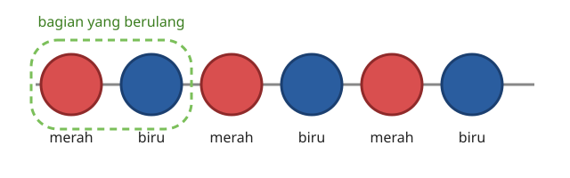

**Ingat dulu:** Tanpa melihat apa pun, gambar kartu arah KIRI atau tunjuk ke arah kirimu.

`[Gambar: kotak kosong di atas kertas dengan gambar kecil kepala berpikir di sudutnya.]`

**Contoh:** Pola: dua hal bergantian. Bagian yang berulang: merah, biru.

`[Gambar: enam lingkaran berurutan: merah, biru, merah, biru, merah, biru. Dua lingkaran pertama dilingkari garis putus-putus dan diberi tulisan "bagian yang berulang". Di bawah tiap lingkaran ada tulisan warnanya.]`

**Bandingkan:**

`[Gambar: dua baris berdampingan. Baris A: merah, biru, merah, biru. Baris B: lingkaran, kotak, lingkaran, kotak.]`

- Apa yang **sama**? Tunjuk.
- Apa yang **beda**? Tunjuk.

**Coba:** Gambar kartu yang kosong.

`[Gambar: baris lima kartu kuning, hijau, kuning, hijau, kuning, lalu satu kotak kosong bertanda tanya.]`

Sekarang sendiri: gambar **dua** kartu yang kosong.

`[Gambar: baris lima kartu merah, merah, biru, merah, merah, lalu dua kotak kosong bertanda tanya.]`

**Ceritakan** ke temanmu: bagian mana yang berulang?

**Catatan cetak (untuk guru, tidak dicetak):** satu lembar per murid, kertas A4; siapkan krayon merah, biru, kuning, dan hijau, dan tulis nama warna di bawah kartu supaya murid yang sulit membedakan warna tetap bisa mengerjakan. Lembar tidak memuat kolom nama, kelompok, tanggal, atau nilai; penandaan kertas diurus guru di sekolah.
