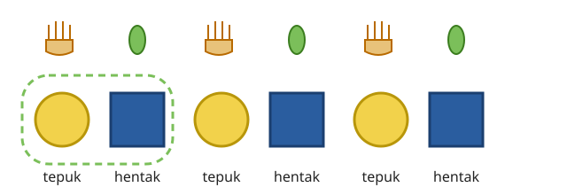

**Ingat dulu:** Tanpa melihat apa pun, tepuk dan hentakkan satu pola yang kamu ingat.

`[Gambar: kotak kosong di atas kertas dengan gambar kecil kepala berpikir di sudutnya.]`

**Contoh:** Bulat berarti tepuk. Kotak berarti hentak. Bagian yang berulang: bulat, kotak.

`[Gambar: enam bentuk berurutan: bulat, kotak, bulat, kotak, bulat, kotak. Di atas bulat ada gambar tangan bertepuk, di atas kotak ada gambar telapak kaki. Dua bentuk pertama dilingkari garis putus-putus.]`

**Bandingkan:**

| A | B |
| --- | --- |
| bulat, kotak, bulat, kotak | bulat, bulat, kotak, bulat, bulat, kotak |

- Apa yang **sama**? Tunjuk.
- Apa yang **beda**? Tunjuk.

**Coba:** Gambar bentuk yang kosong.

bulat, kotak, bulat, kotak, bulat, ____

Sekarang sendiri: gambar **dua** bentuk yang kosong.

bulat, bulat, kotak, bulat, bulat, ____, ____

`[Gambar: baris bentuk berurutan; di akhir baris ada satu atau dua kotak kosong bertanda tanya.]`

**Buat polamu:** gambar enam bentuk, lalu tepuk dan hentakkan untuk temanmu.

`[Gambar: enam kotak kosong berurutan.]`

**Ceritakan** ke temanmu: bagian mana yang berulang?

**Catatan cetak (untuk guru, tidak dicetak):** satu lembar per murid, kertas A4. Lembar tidak memuat kolom nama, kelompok, tanggal, atau nilai; penandaan kertas diurus guru di sekolah.
