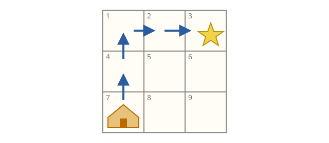

**Ingat dulu:** Tanpa melihat apa pun, gambar satu kartu arah yang kamu ingat.

`[Gambar: kotak kosong di atas kertas dengan gambar kecil kepala berpikir di sudutnya.]`

**Contoh:** Rumah di petak 7. Bintang di petak 3. Panah: atas, atas, kanan, kanan.

`[Gambar: kisi 3x3 bernomor 1 sampai 9, baris atas 1 2 3. Rumah di petak 7 dan bintang di petak 3. Empat panah biru: dari 7 ke 4, dari 4 ke 1, dari 1 ke 2, dari 2 ke 3.]`

**Bandingkan:**

`[Gambar: dua kisi 3x3 berdampingan. Kisi A: jalur atas, atas, kanan, kanan. Kisi B: jalur kanan, kanan, atas, atas. Keduanya dari rumah di petak 7 ke bintang di petak 3.]`

- Apa yang **sama**? Tunjuk.
- Apa yang **beda**? Tunjuk.

**Coba:** Rumah di petak 7, bintang di petak 2. Gambar panah yang kurang.

atas, ____, kanan

`[Gambar: kisi 3x3 bernomor dengan rumah di petak 7 dan bintang di petak 2; satu panah dari 7 ke 4 sudah digambar.]`

Sekarang sendiri: rumah di **petak 9**, bintang di **petak 1**. Gambar jalurmu dengan panah.

`[Gambar: kisi 3x3 bernomor kosong dengan rumah di petak 9 dan bintang di petak 1.]`

Tukar dengan temanmu. Sampai di bintang? Lingkari: ya / belum.

**Ceritakan** ke temanmu: panah mana yang menunjuk petak berikutnya?

**Catatan cetak (untuk guru, tidak dicetak):** satu lembar per murid, kertas A4; kisi dicetak cukup besar supaya panah bisa digambar. Lembar tidak memuat kolom nama, kelompok, tanggal, atau nilai; penandaan kertas diurus guru di sekolah.
