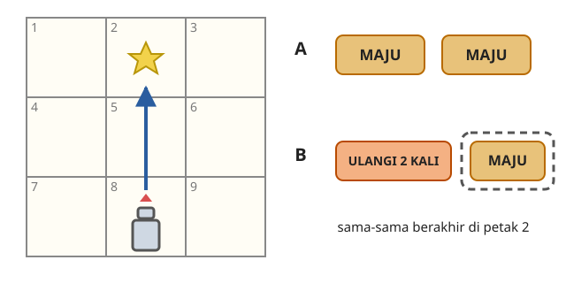

**Ingat dulu:** Tanpa melihat apa pun, gambar pola merah, biru, merah, biru dan lingkari bagian yang berulang.

`[Gambar: kotak kosong di atas kertas dengan gambar kecil kepala berpikir di sudutnya.]`

**Contoh:** Robot mulai di petak 8. Kartu **ULANGI 2 KALI**. Di dalam bingkai: MAJU. Robot maju dua kali.

`[Gambar: kisi 3x3 bernomor 1 sampai 9, baris atas 1 2 3. Robot di petak 8 menghadap atas; panah naik ke petak 5 lalu petak 2, bergambar bintang. Di kanan: kartu ULANGI 2 KALI dan bingkai berisi MAJU.]`

**Bandingkan:**

| A | B |
| --- | --- |
| MAJU, MAJU | ULANGI 2 KALI: [MAJU] |
| petak 2 | petak ____ |

- Apa yang **sama**? Tunjuk.
- Apa yang **beda**? Tunjuk.

**Coba:** Bulat berarti tepuk. Kotak berarti hentak. Tulis semua bunyinya.

ULANGI 2 KALI: [bulat, kotak]

bulat, kotak, ____, ____

`[Gambar: bingkai berisi bulat dan kotak, lalu empat kotak berurutan; dua yang pertama sudah terisi.]`

Sekarang sendiri: robot mulai di **petak 8**. Tujuan **petak 1**. Tempel kartumu. Boleh pakai ULANGI 2 KALI.

`[Gambar: kisi 3x3 bernomor, robot di petak 8, bintang di petak 1; lima kotak kosong di bawahnya.]`

Tukar dengan temanmu. Sampai di petak 1? Lingkari: ya / belum.

**Ceritakan** ke temanmu: apa yang dilakukan kartu ULANGI 2 KALI?

**Catatan cetak (untuk guru, tidak dicetak):** satu lembar per murid, kertas A4; siapkan kartu untuk digunting dan ditempel. Lembar tidak memuat kolom nama, kelompok, tanggal, atau nilai; penandaan kertas diurus guru di sekolah.
