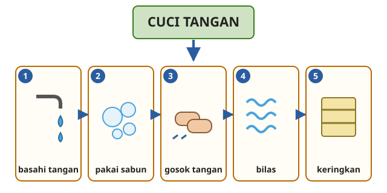

**Ingat dulu:** Tanpa melihat apa pun, gambar kartu ULANGI 2 KALI atau tunjukkan dengan tepuk.

`[Gambar: kotak kosong di atas kertas dengan gambar kecil kepala berpikir di sudutnya.]`

**Contoh:** Tugas besar: **cuci tangan**. Dipecah menjadi lima langkah kecil.

`[Gambar: kartu besar CUCI TANGAN di atas. Di bawahnya lima kartu kecil berurutan dengan angka 1 sampai 5 dan panah di antaranya: keran dengan tetes air, gelembung sabun, dua tangan saling menggosok, air mengalir, handuk.]`

**Bandingkan:**

`[Gambar: dua kolom berdampingan. Kolom A: satu kartu "CUCI TANGAN", robot berdiri bingung dengan tanda tanya. Kolom B: lima kartu langkah, robot melangkah dengan tenang.]`

- Apa yang **sama**? Tunjuk.
- Apa yang **beda**? Tunjuk.

**Coba:** Gambar kartu yang hilang.

basahi tangan, pakai sabun, ____, bilas, keringkan

`[Gambar: lima kotak berurutan; kotak ketiga kosong bertanda tanya.]`

Sekarang sendiri: tugas **menyiram tanaman**. Pecah menjadi tiga atau empat langkah. Gambar atau tempel kartumu.

`[Gambar: empat kotak kosong berurutan dengan panah di antaranya, dan di sebelahnya gambar kecil pot tanaman dan botol air.]`

Tukar dengan temanmu. Bisa dijalankan? Lingkari: ya / belum.

**Ceritakan** ke temanmu: tugas apa yang kamu pecah, dan berapa langkahnya?

**Catatan cetak (untuk guru, tidak dicetak):** satu lembar per murid, kertas A4; siapkan kartu langkah untuk digunting dan ditempel. Lembar tidak memuat kolom nama, kelompok, tanggal, atau nilai; penandaan kertas diurus guru di sekolah.
