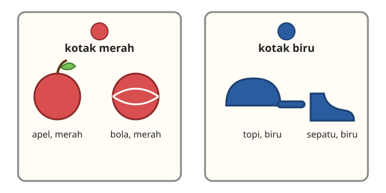

**Ingat dulu:** Tanpa melihat apa pun, sebut satu warna yang kamu ingat.

`[Gambar: kotak kosong di atas kertas dengan gambar kecil kepala berpikir di sudutnya.]`

**Contoh:** Apel merah masuk kotak merah. Topi biru masuk kotak biru.

`[Gambar: dua kotak berdampingan. Kotak merah bertitik merah berisi apel dan bola merah. Kotak biru bertitik biru berisi topi dan sepatu biru. Nama warna tertulis di bawah tiap gambar.]`

**Bandingkan:**

`[Gambar: dua kotak berdampingan, kotak merah berisi apel dan bola, kotak biru berisi topi dan sepatu.]`

- Apa yang **sama**? Tunjuk.
- Apa yang **beda**? Tunjuk.

**Coba:** Tarik garis dari apel ke kotak yang warnanya sama.

`[Gambar: gambar apel merah di tengah, dengan tiga kotak bertitik merah, biru, dan kuning di bawahnya.]`

Sekarang sendiri: tarik garis untuk **pisang**, **topi**, dan **bola**.

`[Gambar: tiga gambar berderet (pisang kuning, topi biru, bola merah), dan tiga kotak bertitik merah, biru, dan kuning di bawahnya.]`

**Ceritakan** ke temanmu: apa yang sama pada semua kartu di satu kotak?

**Catatan cetak (untuk guru, tidak dicetak):** satu lembar per murid, kertas A4; siapkan krayon merah, biru, dan kuning, dan tulis nama warna di bawah gambar supaya murid yang sulit membedakan warna tetap bisa mengerjakan. Lembar tidak memuat kolom nama, kelompok, tanggal, atau nilai; penandaan kertas diurus guru di sekolah.
