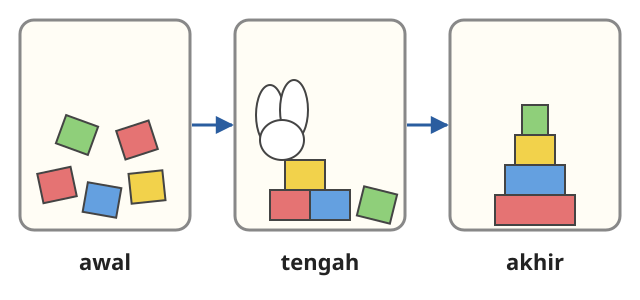

**Ingat dulu:** Tanpa melihat apa pun, sebut tiga langkah sebelum memakai alat digital.

`[Gambar: kotak kosong di atas kertas dengan gambar kecil kepala berpikir di sudutnya.]`

**Contoh:** Menara. **Awal:** balok berserakan. **Tengah:** menyusun. **Akhir:** menara berdiri.

`[Gambar: tiga kartu berurutan dengan panah. Kartu awal: balok berserakan. Kartu tengah: kelinci menyusun balok. Kartu akhir: menara berdiri. Tulisan awal, tengah, akhir di bawah tiap kartu.]`

**Bandingkan:**

`[Gambar: dua baris tiga kartu berdampingan. A: menara. B: Kili melukis, kertas kosong, menggambar bunga, gambar bunga di dinding.]`

- Apa yang **sama**? Tunjuk.
- Apa yang **beda**? Tunjuk.

**Coba:** Potongan gambar. Tulis 1, 2, 3. Kartu awal sudah 1.

`[Gambar: tiga kartu tercampur. Gambar lengkap, potongan berserakan bertanda 1, dan potongan disambung. Garis kosong untuk angka.]`

Sekarang sendiri: roti isi. Tulis 1, 2, 3.

`[Gambar: tiga kartu tercampur. Roti isi siap, roti polos, dan roti sedang diolesi selai. Garis kosong untuk angka.]`

**Ceritakan** ke temanmu: mana awal, mana tengah, mana akhir?

**Catatan cetak (untuk guru, tidak dicetak):** satu lembar per murid, kertas A4; siapkan krayon. Lembar tidak memuat kolom nama, kelompok, tanggal, atau nilai; penandaan kertas diurus guru di sekolah.
