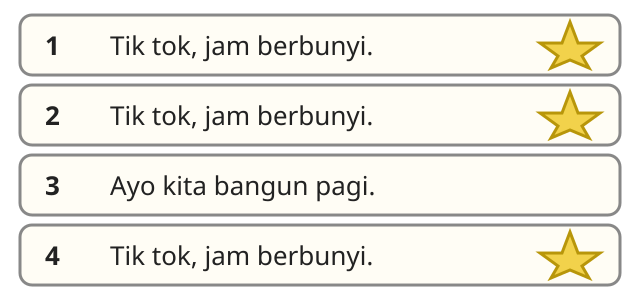

**Ingat dulu:** Tanpa melihat apa pun, gambar pola merah, biru, merah, biru dan lingkari bagian yang berulang.

`[Gambar: kotak kosong di atas kertas dengan gambar kecil kepala berpikir di sudutnya.]`

**Contoh:** Lagu "Tik Tok". Bintang menandai baris yang berulang. "Tik tok, jam berbunyi" diulang **3** kali.

`[Gambar: empat baris lagu. Baris 1: tik tok, jam berbunyi, bertanda bintang. Baris 2: sama, bertanda bintang. Baris 3: ayo kita bangun pagi, tanpa bintang. Baris 4: tik tok, jam berbunyi, bertanda bintang.]`

**Bandingkan:**

`[Gambar: dua lagu berdampingan. A: Tik Tok, satu baris diulang. B: Daun, daun jatuh dan angin bertiup pelan masing-masing dua baris.]`

- Apa yang **sama**? Tunjuk.
- Apa yang **beda**? Tunjuk.

**Coba:** Lagu "Kodok". Baris 1 sudah bintang. Beri bintang pada baris yang sama. Berapa kali? ____

`[Gambar: tiga baris lagu. Baris 1: hop hop, kodok melompat, bertanda bintang. Baris 2: hop hop, kodok melompat. Baris 3: plung, masuk ke kolam.]`

Sekarang sendiri: tepukan. Lingkari bagian yang berulang. Berapa kali? ____

tepuk, hentak, tepuk, hentak, tepuk, hentak, tos

`[Gambar: tujuh kotak berurutan bertulis tepuk, hentak, tepuk, hentak, tepuk, hentak, tos.]`

**Ceritakan** ke temanmu: bagian mana yang berulang, dan berapa kali?

**Catatan cetak (untuk guru, tidak dicetak):** satu lembar per murid, kertas A4; siapkan krayon. Lembar tidak memuat kolom nama, kelompok, tanggal, atau nilai; penandaan kertas diurus guru di sekolah.
