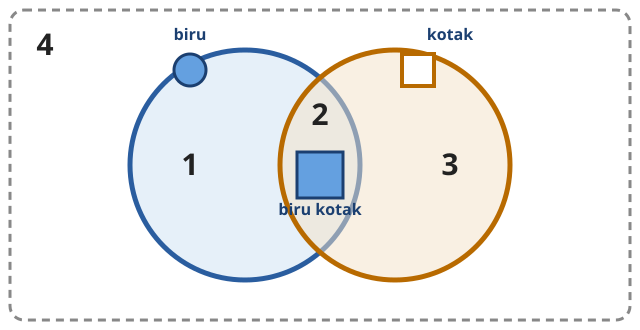

**Ingat dulu:** Tanpa melihat apa pun, sebut satu bagian lagu yang berulang.

`[Gambar: kotak kosong di atas kertas dengan gambar kecil kepala berpikir di sudutnya.]`

**Contoh:** Aturan: kiri **biru**, kanan **kotak**. Kartu biru kotak ada di tengah. Tempatnya angka 2.

`[Gambar: dua lingkaran beririsan. Lingkaran kiri bertitik biru, lingkaran kanan bergambar kotak. Hanya kiri bernomor 1, tengah bernomor 2, hanya kanan bernomor 3, di luar bernomor 4. Kartu biru kotak ada di bagian tengah.]`

**Bandingkan:** kartu **kuning bulat**.

`[Gambar: dua pasang lingkaran berdampingan. A: kiri merah, kanan bulat. B: kiri kuning, kanan segitiga. Kartu kuning bulat ada di bawah tiap pasang.]`

- Apa yang **sama**? Tunjuk.
- Apa yang **beda**? Tunjuk.

**Coba:** Aturan: kiri biru, kanan kotak. Kartu merah kotak. Tulis angka tempatnya. ____

`[Gambar: kartu merah kotak di atas dua lingkaran bernomor 1 sampai 4, dengan garis kosong untuk angka.]`

Sekarang sendiri: aturan kiri **kuning**, kanan **bulat**. Tulis angka tempat **kuning bulat**, **biru segitiga**, **merah bulat**, dan **kuning kotak**.

`[Gambar: empat kartu berderet, kuning bulat, biru segitiga, merah bulat, dan kuning kotak, dengan dua lingkaran bernomor di bawahnya dan empat garis kosong untuk angka.]`

**Ceritakan** ke temanmu: mengapa kartu yang sama bisa masuk tempat berbeda?

**Catatan cetak (untuk guru, tidak dicetak):** satu lembar per murid, kertas A4; siapkan krayon biru, merah, dan kuning, dan tulis nama warna di bawah kartu supaya murid yang sulit membedakan warna tetap bisa mengerjakan. Lembar tidak memuat kolom nama, kelompok, tanggal, atau nilai; penandaan kertas diurus guru di sekolah.
