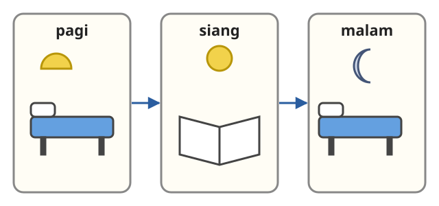

**Ingat dulu:** Tanpa melihat apa pun, sebut kegiatan awal, tengah, dan akhir pada satu cerita tiga kartu.

`[Gambar: kotak kosong di atas kertas dengan gambar kecil kepala berpikir di sudutnya.]`

**Contoh:** Halaman hari-hariku. **Pagi** bangun tidur, **siang** belajar, **malam** tidur.

`[Gambar: tiga kotak berurutan dengan panah. Kotak pagi: tempat tidur dan matahari terbit. Kotak siang: buku dan matahari tinggi. Kotak malam: tempat tidur dan bulan.]`

**Bandingkan:**

`[Gambar: dua halaman berdampingan. A: bangun tidur, bermain, tidur. B: sarapan, belajar, mendengarkan cerita.]`

- Apa yang **sama**? Tunjuk.
- Apa yang **beda**? Tunjuk.

**Coba:** Kotak pagi sudah sarapan. Gambar satu kegiatan siang.

`[Gambar: halaman tiga kotak. Kotak pagi bergambar mangkuk dan sendok. Kotak siang dan malam kosong.]`

Sekarang sendiri: gambar halamanmu. Satu kegiatan tiap kotak.

`[Gambar: halaman tiga kotak kosong bertulisan pagi, siang, malam dengan panah.]`

Temanmu bisa menyebut awal, tengah, akhir? Lingkari: ya / belum.

**Ceritakan** ke temanmu: pertama ..., lalu ..., terakhir ...

**Catatan cetak (untuk guru, tidak dicetak):** satu lembar per murid, kertas A4; siapkan krayon. Lembar tidak memuat kolom nama, kelompok, tanggal, atau nilai; penandaan kertas diurus guru di sekolah.
