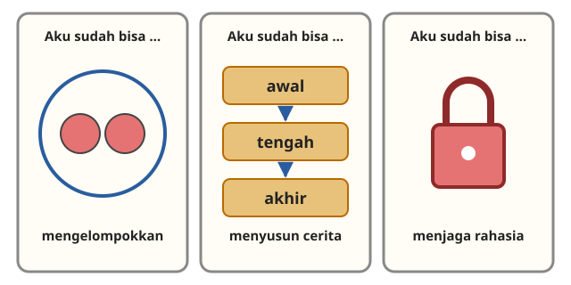

**Ingat dulu:** Tanpa melihat apa pun, tunjukkan satu hal yang kamu pelajari sejak awal semester dua.

`[Gambar: kotak kosong di atas kertas dengan gambar kecil kepala berpikir di sudutnya.]`

**Contoh:** "Aku sudah bisa mengelompokkan kartu."

`[Gambar: tiga bingkai berdampingan. Kiri: lingkaran berisi dua kartu merah. Tengah: tiga kartu berurutan dengan panah. Kanan: gembok tertutup.]`

**Bandingkan:**

`[Gambar: dua bingkai berdampingan. A: lingkaran berisi kartu yang sama warna. B: tiga kartu cerita berurutan.]`

- Apa yang **sama**? Tunjuk.
- Apa yang **beda**? Tunjuk.

**Coba:** Aturan: kiri merah, kanan bulat. Kartu merah bulat. Angka tempatnya ____

`[Gambar: kartu merah bulat di atas dua lingkaran bernomor 1 sampai 4.]`

Sekarang sendiri:

1. Gelas jus. Tulis 1, 2, 3: gelas penuh, gelas kosong, menuang jus.

`[Gambar: tiga kartu tercampur: gelas penuh, gelas kosong, menuang jus, dengan garis kosong untuk angka.]`

2. Di layar, orang asing bertanya alamatmu. Lingkari: memberi tahu / tidak memberi tahu dan tanya orang dewasa.

3. Gambar jalur dengan panah dari **petak 8 ke petak 3**.

`[Gambar: kisi 3x3 bernomor, baris atas 1 2 3. Rumah di petak 8, bintang di petak 3.]`

**Gambarlah:** Aku sudah bisa ...

`[Gambar: bingkai besar kosong.]`

**Ceritakan** ke temanmu: satu hal yang sudah bisa, dan satu hal yang ingin dicoba di kelas 2.

**Catatan cetak (untuk guru, tidak dicetak):** satu lembar per murid, kertas A4; kisi dicetak cukup besar. Lembar tidak memuat kolom nama, kelompok, tanggal, atau nilai; penandaan kertas diurus guru di sekolah.
