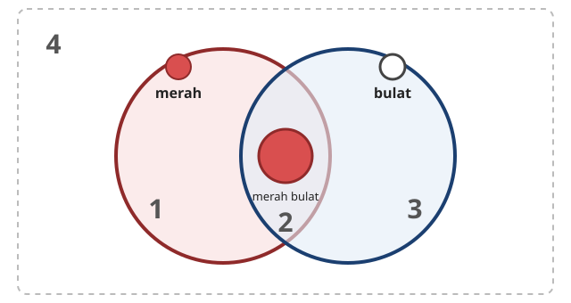

**Ingat dulu:** Tanpa melihat apa pun, sebut satu benda merah.

`[Gambar: kotak kosong di atas kertas dengan gambar kecil kepala berpikir di sudutnya.]`

**Contoh:** Kartu merah bulat ada di tengah. Tempatnya angka 2.

`[Gambar: dua lingkaran beririsan. Lingkaran kiri bertitik merah, lingkaran kanan bergambar bulat. Hanya kiri bernomor 1, tengah bernomor 2, hanya kanan bernomor 3, di luar bernomor 4. Kartu merah bulat ada di bagian tengah.]`

**Bandingkan:**

`[Gambar: dua kartu berdampingan, A merah kotak dan B biru bulat, dengan dua lingkaran sortir di bawahnya.]`

- Apa yang **sama**? Tunjuk.
- Apa yang **beda**? Tunjuk.

**Coba:** Kartu biru kotak. Tulis angka tempatnya.

`[Gambar: kartu biru kotak di atas dua lingkaran bernomor 1 sampai 4, dengan garis kosong untuk angka.]`

Sekarang sendiri: tulis angka tempat **merah segitiga**, **kuning bulat**, dan **kuning segitiga**.

`[Gambar: tiga kartu berderet, merah segitiga, kuning bulat, dan kuning segitiga, dengan dua lingkaran bernomor di bawahnya dan tiga garis kosong untuk angka.]`

**Ceritakan** ke temanmu: mengapa kartu merah bulat ada di tengah?

**Catatan cetak (untuk guru, tidak dicetak):** satu lembar per murid, kertas A4; siapkan krayon merah, biru, dan kuning, dan tulis nama warna di bawah kartu supaya murid yang sulit membedakan warna tetap bisa mengerjakan. Lembar tidak memuat kolom nama, kelompok, tanggal, atau nilai; penandaan kertas diurus guru di sekolah.
