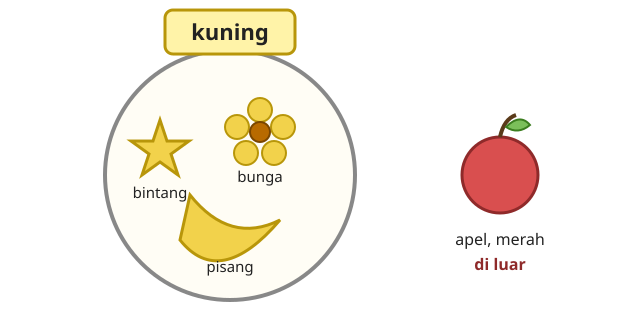

**Ingat dulu:** Tanpa melihat apa pun, gambar satu kartu yang merah dan bulat.

`[Gambar: kotak kosong di atas kertas dengan gambar kecil kepala berpikir di sudutnya.]`

**Contoh:** Bintang, pisang, bunga. Namanya: **kuning**. Apel di luar.

`[Gambar: satu lingkaran berisi bintang, pisang, dan bunga kuning. Kartu nama bertulis kuning di atas lingkaran. Kartu apel merah di luar lingkaran.]`

**Bandingkan:**

`[Gambar: dua lingkaran berdampingan. A berisi bintang, pisang, bunga dengan nama kuning. B berisi bola, koin, jam dinding dengan nama bulat.]`

- Apa yang **sama**? Tunjuk.
- Apa yang **beda**? Tunjuk.

**Coba:** Apel, tomat, payung. Tulis namanya atau tarik garis ke warnanya.

`[Gambar: satu lingkaran berisi apel, tomat, dan payung merah, kartu pisang di luar, dan kartu nama kosong dengan titik merah, biru, dan kuning untuk dipilih.]`

Sekarang sendiri: roda, piring, bulan. Beri nama. Lingkari kartu yang tidak cocok.

`[Gambar: satu lingkaran berisi roda, piring, dan bulan, kartu nama kosong, dan di luar lingkaran satu kartu buku kotak.]`

**Ceritakan** ke temanmu: mengapa kartu ini di luar?

**Catatan cetak (untuk guru, tidak dicetak):** satu lembar per murid, kertas A4; siapkan krayon merah, biru, dan kuning, dan tulis nama warna di bawah kartu supaya murid yang sulit membedakan warna tetap bisa mengerjakan. Lembar tidak memuat kolom nama, kelompok, tanggal, atau nilai; penandaan kertas diurus guru di sekolah.
