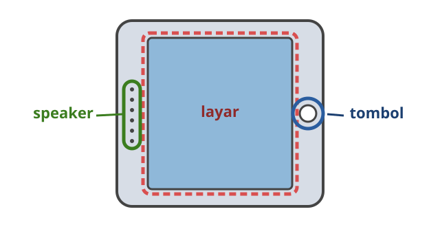

**Ingat dulu:** Tanpa melihat apa pun, sebut satu alat di rumah yang memakai listrik.

`[Gambar: kotak kosong di atas kertas dengan gambar kecil kepala berpikir di sudutnya.]`

**Contoh:** Tablet punya **layar** (merah), **tombol** (biru), dan **speaker** (hijau).

`[Gambar: tablet tampak dari depan. Layar besar di tengah dilingkari merah. Satu tombol bulat di sisi kanan dilingkari biru. Speaker berpola titik di sisi kiri dilingkari hijau. Nama tiap bagian tertulis dekat lingkaran.]`

**Bandingkan:**

`[Gambar: dua gambar berdampingan. A: televisi dengan layar besar, tombol kecil di bawah, speaker di sisi. B: telepon dengan layar hampir penuh, tombol di sisi, speaker di atas layar.]`

- Apa yang **sama**? Tunjuk.
- Apa yang **beda**? Tunjuk.

**Coba:** Telepon. Layar sudah merah. Lingkari **tombol** biru dan **speaker** hijau.

`[Gambar: telepon tampak dari depan. Layar sudah dilingkari merah. Tombol di sisi kanan dan speaker di atas layar belum dilingkari.]`

Sekarang sendiri: radio. Lingkari **layar** merah, **tombol** biru, dan **speaker** hijau.

`[Gambar: radio digital. Layar kecil berangka di atas, tombol bulat di bawah layar, speaker berpola titik di sisi kiri.]`

**Ceritakan** ke temanmu: layar untuk apa? Tombol untuk apa? Speaker untuk apa?

**Catatan cetak (untuk guru, tidak dicetak):** satu lembar per murid, kertas A4; siapkan krayon merah, biru, dan hijau; gambar alat dicetak cukup besar. Lembar tidak memuat kolom nama, kelompok, tanggal, atau nilai; penandaan kertas diurus guru di sekolah.
