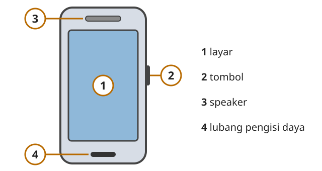

**Ingat dulu:** Tanpa melihat apa pun, sebut satu bagian alat yang kamu ingat.

`[Gambar: kotak kosong di atas kertas dengan gambar kecil kepala berpikir di sudutnya.]`

**Contoh:** Telepon punya empat bagian bernomor. 1 layar. 2 tombol. 3 speaker. 4 lubang pengisi daya.

`[Gambar: telepon tampak dari depan. 1 layar besar, 2 tombol kecil di sisi kanan, 3 speaker di atas layar, 4 lubang pengisi daya di bawah. Di kanan ada daftar nomor dan nama bagian.]`

**Bandingkan:**

`[Gambar: dua gambar berdampingan. A: telepon kecil. B: tablet besar. Keduanya bernomor 1 sampai 4.]`

- Apa yang **sama**? Tunjuk.
- Apa yang **beda**? Tunjuk.

**Coba:** Tablet. Nomor 1 layar. Tarik garis dari nomor **2** ke kata yang cocok.

`[Gambar: tablet bernomor 1 sampai 4. Di sebelah kanan ada empat kartu kata bergambar kecil: layar, tombol, speaker, lubang pengisi daya. Garis dari nomor 1 ke layar sudah ada.]`

Sekarang sendiri: tarik garis dari nomor **3** dan nomor **4** ke kata yang cocok.

`[Gambar: sama dengan gambar di atas, dengan garis dari nomor 1 dan 2 sudah ada.]`

**Ceritakan** ke temanmu: bagian mana untuk melihat? Menekan? Mendengar?

**Catatan cetak (untuk guru, tidak dicetak):** satu lembar per murid, kertas A4; gambar dicetak cukup besar dan kartu kata diberi gambar kecil. Lembar tidak memuat kolom nama, kelompok, tanggal, atau nilai; penandaan kertas diurus guru di sekolah.
