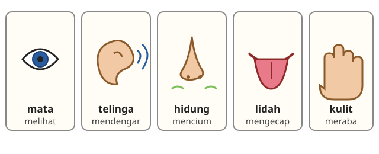

**Ingat dulu:** Tanpa melihat apa pun, sebut satu bagian alat untuk mendengar bunyi.

`[Gambar: kotak kosong di atas kertas dengan gambar kecil kepala berpikir di sudutnya.]`

**Contoh:** Kita punya lima indera. Mata melihat. Telinga mendengar. Hidung mencium. Lidah mengecap. Kulit meraba.

`[Gambar: lima gambar berderet. Mata dengan tulisan melihat, telinga mendengar, hidung mencium, lidah mengecap, tangan meraba.]`

**Bandingkan:**

`[Gambar: dua gambar berdampingan. A: tangan memegang bola karet, mata terpejam. B: telinga dekat botol yang diguncang, mata terpejam.]`

- Apa yang **sama**? Tunjuk.
- Apa yang **beda**? Tunjuk.

**Coba:** Botol berbunyi. Tarik garis dari botol ke indera yang dipakai.

`[Gambar: gambar botol di kiri. Di kanan lima gambar indera: mata, telinga, hidung, lidah, tangan.]`

Sekarang sendiri: tarik garis dari **bola karet** dan dari **kulit jeruk** ke indera yang dipakai.

`[Gambar: dua gambar di kiri, bola karet dan kulit jeruk. Di kanan lima gambar indera.]`

**Ceritakan** ke temanmu: indera apa untuk tahu benda itu berbunyi?

**Catatan cetak (untuk guru, tidak dicetak):** satu lembar per murid, kertas A4; gambar indera dicetak cukup besar. Lembar tidak memuat kolom nama, kelompok, tanggal, atau nilai; penandaan kertas diurus guru di sekolah.
