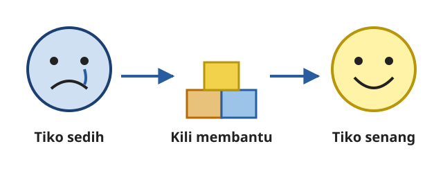

**Ingat dulu:** Tanpa melihat apa pun, gambar satu bagian alat yang kamu tekan.

`[Gambar: kotak kosong di atas kertas dengan gambar kecil kepala berpikir di sudutnya.]`

**Contoh:** Tiko sedih. Kili membantu. Tiko senang.

`[Gambar: tiga lingkaran perasaan berderet dengan tanda panah. Pertama lingkaran sedih bertulis Tiko sedih. Tengah dua balok bertumpuk bertulis Kili membantu. Terakhir lingkaran senang bertulis Tiko senang.]`

**Bandingkan:**

`[Gambar: dua baris gambar berdampingan. Cerita A: Tiko sedih, Kili membantu. Cerita B: Kili marah, Tiko meminta maaf.]`

- Apa yang **sama**? Tunjuk.
- Apa yang **beda**? Tunjuk.

**Coba:** Kili sedih sendirian. Lingkari yang membuat Kili merasa lebih baik.

`[Gambar: Kili sedih di tengah. Di bawahnya tiga kartu: mengajak main, menertawakan, pergi.]`

Sekarang sendiri: Tiko sedih. Pensilnya hilang. Lingkari yang membuat Tiko merasa lebih baik.

`[Gambar: Tiko sedih di tengah. Di bawahnya tiga kartu: membantu mencari, menertawakan, pergi.]`

**Ceritakan** ke temanmu: apa yang bisa kamu lakukan agar temanmu merasa baik?

**Catatan cetak (untuk guru, tidak dicetak):** satu lembar per murid, kertas A4; gambar perasaan dan kartu tindakan dicetak cukup besar. Lembar tidak memuat kolom nama, kelompok, tanggal, atau nilai; penandaan kertas diurus guru di sekolah.
