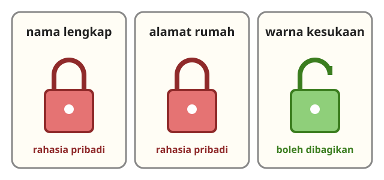

**Ingat dulu:** Tanpa melihat apa pun, sebut satu alat digital di rumah dan satu bagiannya.

`[Gambar: kotak kosong di atas kertas dengan gambar kecil kepala berpikir di sudutnya.]`

**Contoh:** Nama lengkap dan alamat rumah adalah rahasia pribadi. Pakai gembok tertutup. Warna kesukaan boleh dibagikan.

`[Gambar: tiga kartu berdampingan. Kartu nama lengkap dan kartu alamat rumah bergambar gembok tertutup berwarna merah. Kartu warna kesukaan bergambar gembok terbuka berwarna hijau.]`

**Bandingkan:**

`[Gambar: dua kotak berdampingan. A: seseorang tanpa wajah di jalan bertanya kepada Tiko si kelinci. B: tulisan di layar telepon dari orang yang tidak dikenal.]`

- Apa yang **sama**? Tunjuk.
- Apa yang **beda**? Tunjuk.

**Coba:** Orang asing bertanya, "Siapa nama lengkapmu?" Lingkari yang Tiko lakukan.

`[Gambar: dua pilihan. A: Tiko menyebut namanya. B: Tiko menggeleng dan melangkah ke orang dewasa.]`

Sekarang sendiri: tarik garis dari tiap kartu ke gembok yang cocok.

`[Gambar: tiga kartu di kiri: alamat rumah, warna kesukaan, nama lengkap. Di kanan dua gembok: tertutup dan terbuka.]`

**Ceritakan** ke temanmu: apa yang kamu lakukan bila orang asing bertanya nama lengkap dan alamatmu?

**Catatan cetak (untuk guru, tidak dicetak):** satu lembar per murid, kertas A4; siapkan krayon merah dan hijau. Lembar tidak memuat kolom nama, kelompok, tanggal, atau nilai; penandaan kertas diurus guru di sekolah.
