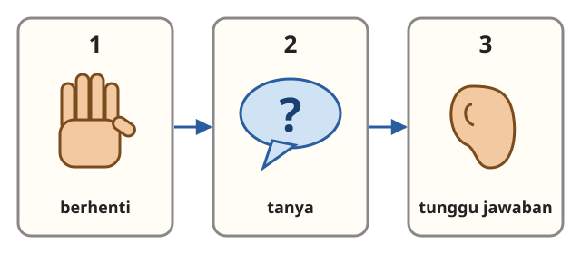

**Ingat dulu:** Tanpa melihat apa pun, sebut satu hal yang tidak kamu berikan kepada orang asing.

`[Gambar: kotak kosong di atas kertas dengan gambar kecil kepala berpikir di sudutnya.]`

**Contoh:** Sebelum memakai alat digital: **1** berhenti, **2** tanya, **3** tunggu jawaban.

`[Gambar: tiga kartu berurutan dengan panah. Kartu 1: tangan terangkat. Kartu 2: gelembung tanda tanya. Kartu 3: telinga.]`

**Bandingkan:**

`[Gambar: dua kotak berdampingan. A: Kili bertanya kepada ibu, ibu menjawab boleh. B: Tiko bertanya kepada ayah, ayah menjawab belum boleh.]`

- Apa yang **sama**? Tunjuk.
- Apa yang **beda**? Tunjuk.

**Coba:** Tulis angka urutannya. Langkah 1 sudah.

`[Gambar: tiga kartu tercampur: gelembung tanya, tangan terangkat bertanda 1, dan telinga, dengan garis kosong untuk angka.]`

Sekarang sendiri: ayah menjawab, "Belum boleh." Lingkari yang Tiko lakukan.

`[Gambar: dua pilihan. A: Tiko bermain balok. B: Tiko menyalakan telepon diam-diam.]`

**Ceritakan** ke temanmu: apa tiga langkah sebelum memakai alat digital?

**Catatan cetak (untuk guru, tidak dicetak):** satu lembar per murid, kertas A4; siapkan krayon. Lembar tidak memuat kolom nama, kelompok, tanggal, atau nilai; penandaan kertas diurus guru di sekolah.
