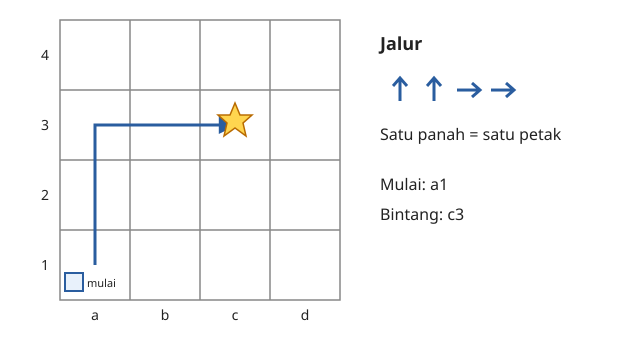

# Panah pada kisi 4x4

**Ingat dulu:** Tanpa melihat catatan, gambar satu panah. Ke mana arahnya?

**Contoh:** Mulai di a1. Bintang di c3. Satu panah berarti satu petak.

`[Gambar: kisi 4x4, kolom a sampai d, baris 1 sampai 4. Jalur panah dari a1 naik ke a3, lalu ke kanan sampai c3, tempat bintang.]`

Jalur: ↑ ↑ → →. Berakhir di c3.

**Bandingkan:**

| | Jalur A | Jalur B |
| --- | --- | --- |
| Panah | ↑ ↑ → → | → → ↑ ↑ |
| Berakhir di | c3 | ______ |

Apa yang sama? ______

Apa yang beda? ______

**Coba:** Mulai di a1. Bintang di b4.

↑ ↑ ______ →

Sekarang sendiri. Mulai di b1. Bintang di d3. Tulis panahmu.

______

Tukar dengan temanmu. Berakhir di d3? ______

**Ceritakan** ke temanmu: mengapa dua jalur bisa sampai di bintang yang sama?

**Catatan cetak (untuk guru, tidak dicetak):** satu lembar per murid, kertas A4. Lembar tidak memuat kolom nama, kelompok, tanggal, atau nilai; penandaan kertas diurus guru di sekolah.
