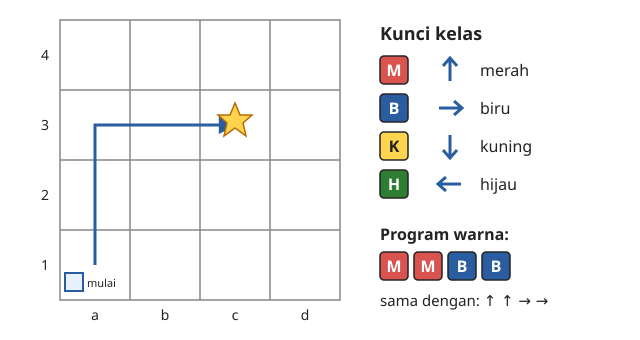

# Kode warna

**Ingat dulu:** Tanpa melihat catatan, tulis mengapa semua orang perlu sepakat tentang arti sebuah tanda.

**Contoh:** Kunci: merah ↑, biru →, kuning ↓, hijau ←. Program: merah, merah, biru, biru. Panah: ↑ ↑ → →. Dari a1 berakhir di c3.

`[Gambar: kisi 4x4 dengan jalur dari a1 ke a3 lalu ke c3, tempat bintang. Di samping ada kunci: M merah atas, B biru kanan, K kuning bawah, H hijau kiri, dan program warna M M B B.]`

**Bandingkan:** Program: merah, merah, biru. Mulai a1.

| | Kunci A | Kunci B |
| --- | --- | --- |
| Merah | ↑ | → |
| Biru | → | ↑ |
| Berakhir di | b3 | ______ |

Apa yang sama? ______

Apa yang beda? ______

**Coba:** ↑ ↑ → → ↓ jadi warna: merah, merah, ____, ____, ____.

Sekarang sendiri. Kunci A. Program: biru, biru, merah, hijau.

Panah: ______

Dari a1 berakhir di: ______

Tukar dengan temanmu. Sama hasilnya? ______

**Ceritakan** ke temanmu: mengapa kunci harus sama bagi yang menulis dan yang menjalankan?

**Catatan cetak (untuk guru, tidak dicetak):** satu lembar per murid, kertas A4. Lembar tidak memuat kolom nama, kelompok, tanggal, atau nilai; penandaan kertas diurus guru di sekolah.
