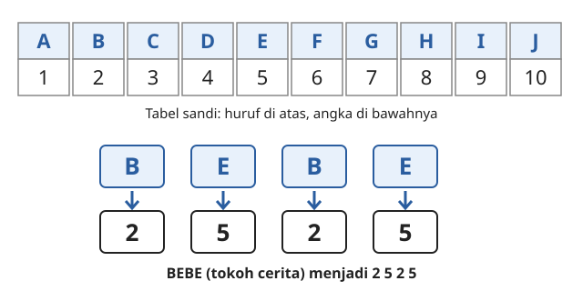

**Ingat dulu:** Tanpa melihat catatan, tulis artinya "ULANGI 2 kali: ↑".

**Contoh:** Tabel: A=1 B=2 C=3 D=4 E=5 F=6 G=7 H=8 I=9 J=10. Tokoh cerita: BEBE si bebek. B=2, E=5, B=2, E=5. Sandi: 2 5 2 5.

`[Gambar: tabel dua baris. Baris atas huruf A sampai J, baris bawah angka 1 sampai 10. Di bawahnya empat kotak huruf B, E, B, E dengan panah turun ke angka 2, 5, 2, 5.]`

**Bandingkan:**

| | BEBE | CICI |
| --- | --- | --- |
| Sandi | 2 5 2 5 | ______ |

Apa yang sama? ______

Apa yang beda? ______

**Coba:** DEDE si dodo: 4 __ 4 __. Isi angka yang hilang.

Sekarang sendiri. Baca sandi 6 9 6 9 dengan tabel:

Huruf: ______

Ciptakan satu tokoh hewan karangan dengan huruf A sampai J. Tulis sandinya:

______

Tukar dengan temanmu. Ia membaca sandinya. Benar? ______

**Ceritakan** ke temanmu: bagaimana kamu membaca sandi angka dengan tabel?

**Catatan cetak (untuk guru, tidak dicetak):** satu lembar per murid, kertas A4. Lembar tidak memuat kolom nama, kelompok, tanggal, atau nilai; penandaan kertas diurus guru di sekolah.
