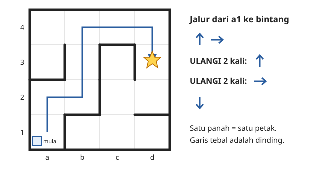

# Penguatan: labirin kelas

**Ingat dulu:** Tanpa melihat catatan, tulis jalur ↑ ↑ → → dengan "ULANGI".

**Contoh:** Mulai a1. Bintang di d3. Garis tebal adalah dinding. Jalur: ↑ → ↑ ↑ → → ↓

`[Gambar: kisi 4x4 dengan garis tebal sebagai dinding. Jalur dari a1 naik ke a2, ke kanan ke b2, naik ke b4, ke kanan ke d4, lalu turun ke d3, tempat bintang.]`

**Bandingkan:**

| | Jalur A | Jalur B |
| --- | --- | --- |
| Tulisan | ↑ → ↑ ↑ → → ↓ | ↑ →, ULANGI 2 kali: ↑, ULANGI 2 kali: →, ↓ |
| Berakhir di | d3 | ______ |

Apa yang sama? ______

Apa yang beda? ______

**Coba:** Bintang pindah ke c4. Jalur: ↑ → ↑ ↑ ____

Sekarang sendiri. Bintang pindah ke d2. Tulis jalur dari a1:

______

Gambar labirin kecilmu di kertas kisi. Minta temanmu menulis jalurnya. Tidak menembus dinding? ______

**Ceritakan** ke temanmu: bagaimana kamu memeriksa jalur tidak menembus dinding?

**Catatan cetak (untuk guru, tidak dicetak):** satu lembar per murid, kertas A4. Lembar tidak memuat kolom nama, kelompok, tanggal, atau nilai; penandaan kertas diurus guru di sekolah.
