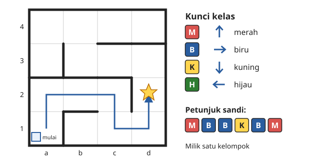

**Ingat dulu:** Tanpa melihat catatan, sebut empat warna kunci kelas dan arahnya.

**Contoh:** Kunci: merah ↑, biru →, kuning ↓, hijau ←. Mulai a1. Bintang di d2. Petunjuk: merah, biru, biru, kuning, biru, merah. Panah: ↑ → → ↓ → ↑

`[Gambar: kisi 4x4 dengan garis tebal sebagai dinding. Jalur dari a1 naik ke a2, ke kanan sampai c2, turun ke c1, ke kanan ke d1, lalu naik ke d2, tempat bintang. Di samping ada kunci empat warna dan enam kotak warna M, B, B, K, B, M.]`

**Bandingkan:**

| | Petunjuk A | Petunjuk B |
| --- | --- | --- |
| Tanda | ↑ → → ↓ → ↑ | merah biru biru kuning biru merah |
| Berakhir di | d2 | ______ |

Apa yang sama? ______

Apa yang beda? ______

**Coba:** Bintang pindah ke c1. Petunjuk: merah, biru, biru, ____.

Sekarang sendiri. Bintang pindah ke d1. Tulis petunjuk warna dari a1:

______

**Proyek kelompok:** gambar labirinmu, tulis petunjuk sandi, tukar dengan kelompok lain. Periksa: tidak menembus dinding? ____ Kunci benar? ____ Berakhir di bintang? ____

**Ceritakan** ke temanmu: apa yang kelompokmu ubah sesudah diuji?

**Catatan cetak (untuk guru, tidak dicetak):** satu lembar per murid, kertas A4. Lembar tidak memuat kolom nama, kelompok, tanggal, atau nilai; penandaan kertas diurus guru di sekolah.
