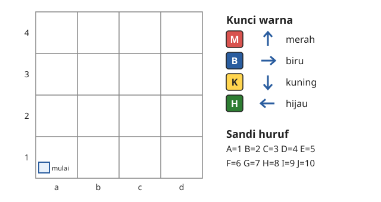

**Ingat dulu:** Tanpa melihat catatan, tulis satu hal dari semester ini yang sudah kamu bisa.

**Contoh:** Mulai b1. ↑ → ↑. Berakhir di c3.

`[Gambar: kisi kerja kosong 4x4 dengan tempat mulai di a1. Di samping ada kunci warna: M merah atas, B biru kanan, K kuning bawah, H hijau kiri, dan tabel sandi huruf A sampai J menjadi 1 sampai 10.]`

**Bandingkan:** Mulai a1. Bintang di b3.

| | Salah | Diperbaiki |
| --- | --- | --- |
| Panah | ↑ ↑ → ↑ | ↑ ↑ → |
| Berakhir di | b4 | ______ |

Apa yang beda? ______

**Coba:** Pakai kisi dan kunci di gambar.

1. Dari a1: ULANGI 3 kali: →. Berakhir di ______.
2. Dari a1: merah, merah, biru. Berakhir di ______.
3. Lanjutkan pola: segitiga, bulat, segitiga, bulat, ____, ____.
4. Jika hujan, maka ______.
5. Sandi 2 5 2 5 dibaca: ______.

**Ceritakan** ke temanmu: satu hal yang sudah bisa, satu hal yang masih ingin dilatih, dan satu cara melatihnya.

**Catatan cetak (untuk guru, tidak dicetak):** satu lembar per murid, kertas A4. Lembar tidak memuat kolom nama, kelompok, tanggal, atau nilai; penandaan kertas diurus guru di sekolah.
